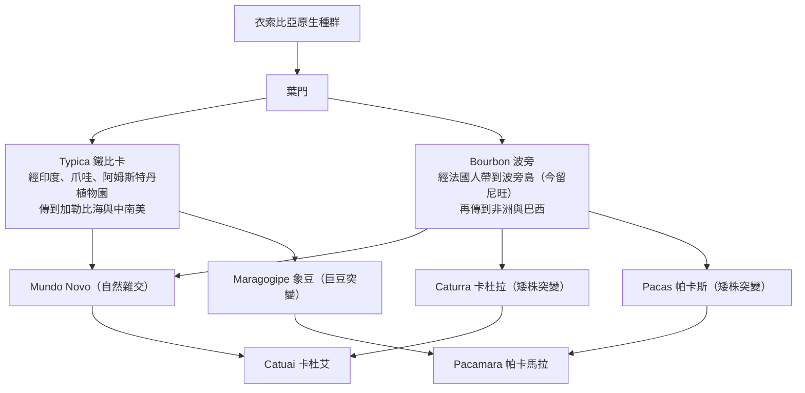

<callout icon="🎯" color="brown_bg">
<b>學習目標</b>

- 認識咖啡植物與咖啡櫻桃的結構
- 分辨主要物種與重要品種，知道它們的風味傾向與來龍去脈
- 理解各種處理法如何改變風味，能讀懂一包豆子的標籤
</callout>

## 1. 咖啡是一種植物的種子

你手上的咖啡豆原本長在樹上。先弄清楚它是植物的哪個部位、外面包著什麼，後面講處理法時，你才知道每個步驟在處理哪一層。

咖啡屬於<b>茜草科（Rubiaceae）咖啡屬（Coffea）</b>。依 2021 年的統計，已描述的物種約一百三十種，但商業上重要的只有少數幾種。「咖啡豆」其實是咖啡樹果實裡的種子，這種果實外型像櫻桃，常稱為<b>咖啡櫻桃</b>。

### 咖啡櫻桃的結構（由外到內）

咖啡櫻桃像一份層層包裹的禮物，拆到最裡面才是種子。第三欄先預告每一層和處理法的關係。

| 層 | 說明 | 與處理法的關係 |
| --- | --- | --- |
| 外果皮（skin） | 成熟時多為紅色，也有黃色、橘色、粉紅色的品種 | 水洗與蜜處理會先去除 |
| 果肉（pulp） | 含糖的果肉，曬乾後就是「卡斯卡拉」（Cascara，咖啡果皮茶） | 日曬處理保留果肉一起乾燥，帶來果香與酒香 |
| 果膠層（mucilage） | 黏滑、富含糖與果膠的一層 | 蜜處理保留這層一起乾燥；水洗靠發酵去除 |
| 內果皮（parchment，羊皮紙層） | 包覆種子的硬質薄殼 | 豆子帶著這層殼乾燥，出口前才脫殼 |
| 銀皮（silver skin） | 貼在種子表面的薄膜 | 烘焙時剝落，就是烘豆時的「皮屑」 |
| 種子（bean） | 通常一顆果實有兩粒，平面相對 | 一般估計約 5 至 10% 的果實只長出一粒圓形種子，稱<b>圓豆（peaberry）</b>，比例依品種、環境與年份而異 |

阿拉比卡從開花到果實成熟大約需要六到九個月（依氣候與品種而異，羅布斯塔更久）。同一株樹上的果實成熟時間不一，所以精品咖啡通常以人工<b>分批挑選成熟果實</b>，這是品質的重要來源，也是成本高的主因之一。

## 2. 主要物種

罐裝咖啡和單品咖啡喝起來差很多，主因之一是物種不同。市場上最主要的是阿拉比卡與羅布斯塔，差異從染色體一路影響到種在哪裡、喝起來怎樣：

|  | 阿拉比卡（Coffea arabica） | 羅布斯塔（Coffea canephora，常稱 Robusta） |
| --- | --- | --- |
| 遺傳 | 四倍體（44 條染色體），由 canephora 與 eugenioides 天然雜交而來，可自花授粉，遺傳多樣性低 | 二倍體（22 條），需異花授粉，遺傳多樣性高 |
| 生長環境 | 較高海拔（約 1,000 至 2,200 公尺）、涼爽氣候，怕病蟲害與高溫 | 低海拔、耐熱、抗病、產量高 |
| 咖啡因 | 約 1.0 至 1.5% | 約 2 至 2.7%（咖啡因本身也是天然的防蟲物質） |
| 糖與油脂 | 較高，風味甜、酸質豐富、香氣複雜 | 較低，苦味明顯，常帶木質、穀物、橡膠感 |
| 主要用途 | 精品咖啡、大部分單品 | 即溶咖啡、義式配方豆（增加 crema 與苦韻）、罐裝咖啡 |
| 產量占比 | 依 ICO 2024/25 年度統計約占全球六成弱（約 57%），逐年變動 | 約四成多（約 43%），越南為最大產國 |

「自花授粉」指一朵花自己就能結果，後代彼此很像，遇到新病害時比較脆弱，第 3 節的葉鏽病就是例子。

阿拉比卡的遺傳多樣性到底有多低？World Coffee Research 參與、2020 年發表的基因研究指出，阿拉比卡很可能來自同一次 canephora 與 eugenioides 的天然雜交，今天世界各地的阿拉比卡都源自約一萬到兩萬年前的同一株植物，遺傳多樣性比其他主要作物都低。這也是育種單位近年積極發展 F1 雜交種、並從其他咖啡物種引進抗性的原因。

其他物種：

- <b>賴比瑞卡（Liberica）</b>與其變種 Excelsa：豆子大，風味偏煙燻木質或特殊果香，主要產在菲律賓、馬來西亞。
- <b>Stenophylla</b>：原生於西非（如獅子山）的物種。2021 年英國邱園（Kew）等團隊的研究指出它比阿拉比卡耐熱，風味被評為接近阿拉比卡，因此在氣候變遷研究中受到關注。

氣候變遷正讓適合阿拉比卡的土地逐漸減少，這是近年羅布斯塔精品化（Fine Robusta）與新物種研究的背景。

## 3. 阿拉比卡的品種家譜

標籤上的「藝妓」「波旁」「SL28」是品種，像蘋果裡的富士和五爪，會影響風味、產量與抗病力。幾乎所有阿拉比卡商業品種，都源自從葉門傳出的兩條古老分支，再經突變與雜交衍生：



### 重要品種速查

風味傾向是一般印象，實際仍受產地、處理與烘焙影響。

| 品種 | 來歷 | 風味傾向 |
| --- | --- | --- |
| Typica 鐵比卡 | 最古老的傳播分支之一，產量低 | 乾淨、甜、柔和 |
| Bourbon 波旁 | 另一條古老分支，有紅、黃、粉紅等果色變異 | 甜感明顯、圓潤、焦糖與水果 |
| Caturra 卡杜拉 | 約 1915 至 1918 年間在巴西米納斯吉拉斯州發現的波旁矮株突變，1937 年起由坎皮納斯農業研究所（IAC）選育；好採收、可密植 | 明亮酸質、中等醇厚 |
| Catuai 卡杜艾 | 巴西育成（Mundo Novo × Caturra） | 平衡、產量穩定，中南美大量種植 |
| Geisha／Gesha 藝妓 | 1930 年代採集自衣索比亞 Gesha 一帶，經東非研究站與哥斯大黎加 CATIE 種原庫傳到巴拿馬；2004 年巴拿馬 Hacienda La Esmeralda 以它參加 Best of Panama 一鳴驚人 | 茉莉花、佛手柑、蜜桃、紅茶般的輕盈質地，是高價競標的常客 |
| SL28 / SL34 | 1930 年代肯亞 Scott Agricultural Laboratories 選育（SL28 於 1935 年選出） | 黑醋栗、番茄、莓果，明亮多汁的酸質 |
| Pacamara 帕卡馬拉 | Pacas 與 Maragogipe 的雜交，由薩爾瓦多咖啡研究所（ISIC）選育，豆子非常大；植株性狀不穩定，易染葉鏽病 | 香料、熱帶水果、有時帶草本，個性強烈 |
| 衣索比亞原生種（Heirloom／Landrace） | 衣索比亞數千種原生與地方選育品種的統稱，包含研究機構選育的編號品系（例如 74110、74112） | 花香、柑橘、莓果、茶感 |
| Catimor／Sarchimor 系 | 含「帝汶雜交種」（阿拉比卡與羅布斯塔的天然雜交）血統，抗葉鏽病 | 傳統上風味較平淡，但新選育品系已改善 |
| F1 雜交種（如 Centroamericano H1） | 近年為兼顧產量、抗病與風味而選育 | 品質穩定，是應對氣候變遷的方向 |
| Sidra、Pink Bourbon、Wush Wush | 近年在比賽與精品市場受關注的品種，身世多有討論 | 常見花香、熱帶水果、甜感高 |
| Laurina（Bourbon Pointu） | 波旁的天然突變，豆形尖長 | 常見說法是咖啡因約只有一般阿拉比卡的一半，實測值差異不小 |

表中好幾個品種標榜抗病，背後是一段產業歷史。<b>葉鏽病（Coffee Leaf Rust）</b>是由真菌引起的病害，會讓咖啡樹落葉、減產，嚴重時甚至死亡。2012 至 2013 年它在中美洲與墨西哥大規模爆發，ICO 稱是當地 1976 年出現此病以來最嚴重的一次，重創小農，也加速了抗病品種與國際研究組織（例如 World Coffee Research）的品種計畫。這說明了為什麼很多產區要在「風味」與「存活」之間取捨。

## 4. 處理法：決定風味的第二個關鍵

同一個品種，水洗和日曬喝起來可以像兩種咖啡。這一節說明果實摘下後發生了什麼，以及這些步驟如何留在你的杯子裡。

採收後，要把種子從果實中取出，並乾燥到含水率約 <b>10 至 12%</b>，才能穩定保存運送。取出與乾燥的方式就是「處理法」，影響往往不亞於品種；差別說穿了就是第 1 節那幾層「哪些留著一起乾燥、哪些先去掉」。

### 水洗（Washed / Fully Washed）

水洗是把果皮、果肉、果膠都去乾淨再乾燥：

1. 浮選，去除未熟與瑕疵果（不良果較輕會浮起）
2. 去皮機除去外果皮與果肉
3. 在水槽中<b>發酵</b>約 12 至 72 小時（多數在一到兩天內完成，依氣溫、海拔與果膠量而異），讓微生物分解果膠層
4. 用清水洗淨，帶著羊皮紙層乾燥

果肉與果膠沒參與乾燥，所以水洗風味<b>乾淨、明亮、酸質清晰</b>，最能表現品種與產地特色。肯亞常用「雙重發酵」（發酵、清洗、再浸泡），帶來更乾淨多汁的酸質。

### 日曬（Natural / Dry Process）

日曬則是整顆果實連皮帶肉曬乾，像曬葡萄乾：

1. 整顆果實直接鋪在曝曬場，或架高的棚架（raised bed）上
2. 定時翻動，依天氣約 2 至 4 週乾燥
3. 乾燥後一次去除乾硬的果皮、果肉與羊皮紙

果肉的糖分與發酵讓日曬咖啡帶<b>濃郁果香</b>、莓果、酒香，醇厚、甜感明顯；處理不好會有過度發酵、泥土或霉味。它是衣索比亞、巴西、葉門的傳統做法，幾乎不用水，也是缺水地區的選擇。

### 蜜處理（Honey / Pulped Natural）

蜜處理介於兩者之間：

1. 去除外果皮與果肉，<b>保留部分或全部果膠層</b>
2. 直接乾燥

「蜜」不是蜂蜜，而是黏稠含糖的果膠。保留越多、乾燥越慢，顏色越深，常分為白蜜、黃蜜、紅蜜、黑蜜（依業者定義而異，不是國際標準）。風味介於水洗與日曬之間：甜感與醇厚提高，又保留一定乾淨度。哥斯大黎加的微型處理廠讓它發揚光大；巴西的「半日曬」（Pulped Natural）是相近的做法。

### 濕剝（Giling Basah / Wet Hulled）

濕剝是印尼（尤其蘇門答臘）特有的做法：羊皮紙豆在含水率還很高時就脫殼，再乾燥生豆。原因是氣候潮濕難以完整乾燥，小農也需要快速換現金。

這種處理讓風味<b>厚重醇厚、低酸</b>，帶土壤、木質、香料、草本調性，生豆常呈藍綠色。曼特寧（Mandheling）就是這種風味的代表。

### 實驗性與發酵處理

近十年，生產者開始主動控制發酵條件（微生物分解果實中的糖，概念和釀酒、做優格相近），創造更強烈的風味：

| 處理 | 做法 | 風味特徵 |
| --- | --- | --- |
| 厭氧發酵（Anaerobic） | 果實或去皮後的種子放進密閉槽，隔絕氧氣發酵，控制時間與溫度 | 濃郁熱帶水果、酒香、肉桂、優格感；強度高 |
| 二氧化碳浸漬（Carbonic Maceration） | 借用薄酒萊葡萄酒的做法，在充滿 CO2 的密閉槽中讓果實（整顆或去皮）發酵；2015 年世界咖啡師冠軍 Saša Šestić 以此處理的豆子奪冠，讓它廣為人知 | 明亮的莓果、紅酒、泡泡糖般的甜香 |
| 接種發酵 | 加入特定酵母或乳酸菌控制發酵 | 風味較可控，可重現 |
| 熱衝擊（Thermal Shock）等 | 以冷熱水交替處理，常配合厭氧 | 香氣極度外放 |
| 加味浸漬（Infused / Co-ferment） | 在發酵時加入水果、香料或其他材料 | 香氣鮮明但<b>具爭議</b>：風味不完全來自咖啡本身，許多比賽與烘豆商要求揭露 |

如何看待？發酵處理是精品咖啡近十年最大的變化之一，讓風味更多元，也有人批評它掩蓋了產地與品種特色。專業的態度是：<b>誠實標示、分開評價</b>。

## 5. 生豆分級與標示

生豆出口時，買賣雙方需要共通語言，標籤上的「AA」「G1」「SHB」就是分級用語。看懂它們衡量什麼，也要知道它們不能告訴你什麼。

- <b>尺寸分級</b>：以篩網（screen）號數表示，號數以 1/64 英吋為單位，例如 Screen 18 代表孔徑 18/64 英吋。肯亞的 AA（最大）、AB、PB（圓豆），哥倫比亞的 Supremo（大）、Excelso
- <b>海拔分級</b>：中美洲常用 SHB（Strictly Hard Bean，極硬豆，高海拔）、HB 等；海拔高、生長慢，豆子通常越密實
- <b>瑕疵分級</b>：依 SCA 生豆分級規範，精品級在 350 公克樣本中不得有一級瑕疵，二級瑕疵換算後不超過 5 個。SCA 現行的咖啡價值評估（CVA）中，生豆的「物理評估」仍以這套 2004 年的分級系統為基礎
- <b>國家等級</b>：衣索比亞以 G1、G2 等數字分級（G1 最好），依瑕疵數與杯測結果評定，常見說法是 G1 至 G5，也有資料列到 G9，制度曾經調整；印尼也有 G1 等級。各國標準不同

分級不等於風味好壞，它只代表外觀與一致性，最終仍要看<b>杯測分數</b>（見第 04 篇）。

## 6. 低咖啡因處理

低因咖啡是在生豆階段去除咖啡因，方法不同，對風味的影響也不同：

| 方法 | 原理 | 特色 |
| --- | --- | --- |
| 瑞士水處理（Swiss Water） | 以含飽和生豆可溶物的水浸泡，透過濃度差與活性碳過濾只移除咖啡因 | 不用化學溶劑，保留風味較好 |
| Mountain Water | 原理類似，由墨西哥的 Descamex 處理廠以當地山區水源進行 | 同上 |
| 二氧化碳法（超臨界 CO2） | 以高壓 CO2 選擇性溶出咖啡因 | 適合大量處理 |
| 乙酸乙酯法（EA，甘蔗法） | 以從甘蔗發酵取得的乙酸乙酯萃取咖啡因 | 哥倫比亞常見（例如當地的 Descafecol 處理廠），有時帶一點甜的水果感 |

瑞士水的關鍵在「飽和」：水裡已溶滿風味物質、只缺咖啡因，就像加滿糖的水再也溶不進糖，所以只有咖啡因會往水裡跑。

## 7. 讀懂一包豆子的標籤

把前面幾節串起來，你已經能從標籤推測一杯咖啡的樣子：

```txt
衣索比亞 耶加雪菲 科契爾 G1 水洗
產區：Gedeo Zone, Yirgacheffe, Kochere 科契爾
品種：原生種（74110 / 74112）
海拔：1,900–2,100 m
處理：水洗
烘焙度：淺焙
風味：茉莉花、檸檬、蜂蜜、紅茶
烘焙日：2026-09-20
```

可以推理出：高海拔（酸質明亮、密度高、可淺焙）＋ 衣索比亞原生種（花香）＋ 水洗（乾淨）＋ 淺焙，會得到輕盈、花香、明亮的一杯。如果同一支豆子是日曬，就會預期更多莓果與醇厚度。

## 參考資料

- [Six New Coffee Species Identified in Madagascar](https://dailycoffeenews.com/2021/09/09/six-new-coffee-species-identified-in-madagascar)：2021 年新增後，已知物種約 130 種
- [CIRAD: Coffee, plant and uses](https://www.cirad.fr/en/our-activities-our-impact/tropical-value-chains/coffee/plant-and-uses)：開花到成熟所需時間
- [CIRAD: Coffea stenophylla press release](https://www.cirad.fr/en/press-area/press-releases/2021/coffea-stenophylla-coffee-climate-change)：Stenophylla 耐熱、風味近似阿拉比卡
- [Catuai & Yellow Bourbon（Perfect Daily Grind）](https://perfectdailygrind.com/2020/02/catuai-yellow-bourbon-exploring-brazils-coffee-varieties/)：Caturra 約 1915 至 1918 年在米納斯吉拉斯州被發現
- [SL28（World Coffee Research）](https://varieties.worldcoffeeresearch.org/varieties/sl28)：SL28 於 1935 年由肯亞 Scott Agricultural Laboratories 選出
- [Our Story（Hacienda La Esmeralda）](https://haciendaesmeralda.com/our-story/)：藝妓經 CATIE 傳入，2004 年參加 Best of Panama
- [What Is Laurina Coffee?](https://perfectdailygrind.com/2022/04/what-is-laurina-coffee/)：Laurina 咖啡因約為一般阿拉比卡的一半
- [The coffee rust crises in Colombia and Central America](https://link.springer.com/article/10.1007/s12571-015-0446-9)：2012 至 2013 年中美洲葉鏽病疫情
- [Sasa Sestic Is the 2015 World Barista Champion](https://dailycoffeenews.com/2015/04/12/australias-sasa-sestic-is-the-2015-world-barista-champion)：Saša Šestić 為 2015 年世界咖啡師冠軍
- [Protocols & Best Practices（SCA）](https://sca.coffee/research/protocols-best-practices)：精品生豆瑕疵標準與 CVA
- [Coffee Value Assessment（SCA）](https://sca.coffee/value-assessment)：CVA 的物理評估以 2004 年 SCA 生豆分級系統為基礎
- [Study: All Arabica derived from a single ancestral plant（World Coffee Research）](https://worldcoffeeresearch.org/news/2020/study-all-arabica-derived-from-a-single-ancestral-plant)：阿拉比卡源自 canephora 與 eugenioides 的單次雜交，遺傳多樣性極低
- [Genetic diversity of Coffea arabica（Scientific Reports, 2020）](https://www.nature.com/articles/s41598-020-61216-7)：阿拉比卡為 2n = 4x = 44 的異源多倍體，自花授粉
- [Pacamara（World Coffee Research）](https://varieties.worldcoffeeresearch.org/varieties/pacamara)：Pacas × Maragogipe，ISIC 選育，易染葉鏽病
- [How coffee is processed（IFT Food Technology）](https://www.ift.org/news-and-publications/food-technology-magazine/issues/2017/september/columns/processing-how-coffee-is-processed)：水洗發酵與日曬乾燥所需時間
- [How Coffee Makes the Grade（Cafe Imports）](https://www.cafeimports.com/australia/blog/?p=44045)：衣索比亞數字分級制度
- [Mountain Water Process Decaf（InterAmerican Coffee）](https://interamericancoffee.com/decaf-mountain-water-process-mwp/)：Mountain Water 由墨西哥 Descamex 處理
- [Swiss Water: The Science Behind Chemical-Free Decaf](https://www.swisswater.com/blogs/sw/watch-the-science-behind-chemical-free-decaf-coffee-swiss-water-process)：瑞士水處理原理

## 自我檢核

<callout icon="💬" color="gray_bg">
先自己回答，再展開參考答案。
</callout>

<toggle>
Q1 咖啡櫻桃由外到內有哪幾層？哪一層決定了蜜處理的「蜜」？

外果皮、果肉、果膠層、內果皮（羊皮紙）、銀皮、種子。蜜處理的「蜜」指的是保留下來的果膠層（mucilage），它黏滑含糖，乾燥時會影響甜感與醇厚度。
</toggle>

<toggle>
Q2 為什麼阿拉比卡通常比羅布斯塔更受精品市場青睞？羅布斯塔有什麼存在價值？

阿拉比卡的糖與油脂較高、咖啡因較低，風味更甜，酸質與香氣也更複雜。羅布斯塔耐熱抗病、產量高、咖啡因高，能以較低成本供應大眾市場，在義式配方中增加 crema 與苦韻；加上氣候變遷使阿拉比卡的適合種植區縮小，精品羅布斯塔與相關研究的價值正在提高。
</toggle>

<toggle>
Q3 藝妓（Geisha）為什麼會成為高價咖啡的代名詞？

它源自衣索比亞 Gesha 一帶，後來經哥斯大黎加 CATIE 傳到巴拿馬。2004 年 Hacienda La Esmeralda 以它參加 Best of Panama 競賽，展現出罕見的茉莉花、佛手柑、蜜桃香氣與茶般質地，拍出極高價格，之後持續在競標與比賽中刷新紀錄，成為精品咖啡的象徵品種。
</toggle>

<toggle>
Q4 同一支豆子分別做水洗與日曬，你預期風味有什麼差異？

水洗：乾淨、明亮、酸質清晰，更能呈現品種與產地本身的特色。日曬：果香與酒香更濃郁、甜感與醇厚度更高，但乾淨度較低，處理不當可能出現過度發酵或土味。
</toggle>

<toggle>
Q5 曼特寧為什麼常有土壤、木質、厚重低酸的風味？

主要來自印尼蘇門答臘的濕剝處理（Giling Basah）：羊皮紙豆在含水率仍高時就脫殼，再乾燥生豆。這種處理加上當地品種與潮濕氣候，形成厚重、低酸、土壤、木質、香料與草本的風味。
</toggle>

<toggle>
Q6 加味浸漬（Infused）處理為什麼具爭議？你會怎麼跟客人說明？

因為部分香氣來自添加的水果或香料，而不是咖啡本身的品種、產地與處理，若未揭露可能誤導消費者，也不利公平比較。說明時應誠實標示處理方式，讓客人知道風味的來源，並把它和傳統處理分開評價。
</toggle>

<toggle>
Q7 什麼是圓豆（Peaberry）？為什麼有人特別挑出來販售？

正常一顆果實有兩粒平面相對的種子，一般估計約 5 至 10% 的果實只發育出一粒圓形種子。有些產區（如坦尚尼亞、肯亞的 PB 等級）會挑出來販售，因為豆形均勻、烘焙較一致，有人認為風味更集中，但這不是絕對。
</toggle>

<toggle>
Q8 葉鏽病對咖啡產業造成什麼影響？

它是真菌引起的病害，會讓咖啡樹落葉、減產甚至死亡。2012 至 2013 年在中美洲與墨西哥大規模爆發，重創小農生計，也加速了抗病品種（含帝汶雜交種血統的品系、F1 雜交種）與國際品種研究計畫，讓產區在風味與抗病之間重新取捨。
</toggle>

<toggle>
Q9 看到標籤寫「肯亞 Nyeri AA 水洗 SL28」，你能推理出什麼？

AA 是肯亞尺寸分級中最大的顆粒；SL28 是肯亞選育的經典品種，常帶黑醋栗、莓果與番茄般的明亮酸質；水洗（肯亞常用雙重發酵）讓風味乾淨多汁；Nyeri 是肯亞著名的高品質產區。整體預期：明亮多汁的酸、莓果與黑醋栗、甜感與清晰的結構。
</toggle>

<toggle>
Q10 瑞士水處理低因咖啡的原理是什麼？

先用生豆製作含有飽和可溶風味物質、但已去除咖啡因的水，再用這種水浸泡新的生豆。由於風味物質已經飽和，只有咖啡因會因濃度差從豆子溶出，再以活性碳過濾移除。整個過程不使用化學溶劑，保留較多風味。
</toggle>
