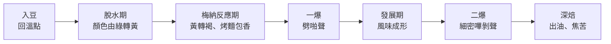

<callout icon="🎯" color="brown_bg">
<b>學習目標</b>

- 理解烘焙過程中豆子發生的物理與化學變化
- 看懂烘焙曲線，知道各階段如何影響風味
- 能依烘焙度挑選適合的沖煮方式，並正確養豆與保存
</callout>

## 1. 為什麼要烘焙

生豆堅硬、帶青草與豆類氣味，幾乎沒有我們熟悉的咖啡香。烘焙透過加熱，讓生豆中的糖、胺基酸、有機酸、脂質發生數百種化學反應，產生<b>上千種香氣化合物</b>。同一支生豆，不同烘焙可以喝起來像完全不同的咖啡。

## 2. 烘焙的階段

| 階段 | 豆溫（大約，依機器與探針位置不同） | 發生什麼 |
| --- | --- | --- |
| <b>入豆與回溫點</b> | 入豆後豆溫讀數先下降再回升 | 冷的豆子吸熱，讀數最低點稱為回溫點（turning point） |
| <b>脫水期（乾燥期）</b> | 到約 150°C | 生豆含水約 10 至 12%，水分蒸發，顏色由綠轉黃，出現青草、稻草、烤吐司前兆氣味 |
| <b>梅納反應期</b> | 約 150°C 到一爆 | 糖與胺基酸反應產生褐色物質與大量香氣（烤麵包、堅果、焦糖）；焦糖化也開始 |
| <b>一爆（First Crack）</b> | 約 195 至 205°C | 豆內水蒸氣與二氧化碳壓力使細胞壁破裂，發出類似爆米花的劈啪聲，體積膨脹 |
| <b>發展期（Development）</b> | 一爆開始到下豆 | 風味平衡在此決定：酸、甜、苦的比例與香氣的成熟度 |
| <b>二爆（Second Crack）</b> | 約 220 至 230°C | 細胞結構進一步崩解，聲音細密，油脂開始滲出表面，烘焙味與苦味主導 |

## 3. 關鍵化學反應

- <b>梅納反應（Maillard Reaction）</b>：還原糖與胺基酸反應，產生類黑素（褐色）與吡嗪、呋喃等香氣分子，帶來烤麵包、堅果、烘烤香
- <b>焦糖化（Caramelization）</b>：蔗糖受熱分解，產生焦糖、楓糖香；過度則轉為苦味。咖啡生豆中的蔗糖在烘焙中大量消耗，烘得越深，甜感先升後降
- <b>有機酸變化</b>：綠原酸（Chlorogenic acid）分解，產生奎寧酸與咖啡酸等，讓咖啡的酸從「明亮」轉向「澀、苦」；檸檬酸、蘋果酸在烘焙中逐漸減少
- <b>史崔克降解（Strecker Degradation）</b>：梅納反應的分支，產生醛類，貢獻許多香氣
- <b>二氧化碳生成</b>：烘焙產生大量 CO2 保留在豆子內，之後緩慢釋放，這是「養豆」與「悶蒸」的原因
- <b>咖啡因</b>：相當穩定，不因烘焙深淺有顯著變化；但深焙豆較輕，若以體積（湯匙）計量，深焙豆咖啡因反而較少

## 4. 烘焙度

| 烘焙度 | 常見說法 | 下豆時機 | 風味特徵 | 適合 |
| --- | --- | --- | --- | --- |
| 極淺焙 | Light, Cinnamon | 一爆剛開始或密集時 | 酸強、花果香，發展不足會有青草、穀物、生豆味 | 杯測、北歐風格手沖 |
| 淺焙 | Light, City（日式「城市烘焙」） | 一爆結束前後 | 明亮酸質、花香、果香、茶感 | 手沖、單品 |
| 中焙 | Medium, City+ | 一爆結束後、二爆前 | 酸甜平衡、焦糖、堅果 | 手沖、義式單品 |
| 中深焙 | Full City | 接近二爆 | 甜感與醇厚提高、巧克力、酸降低 | 義式、加奶飲品 |
| 深焙 | Full City+、Vienna、French | 二爆中 | 苦甜巧克力、煙燻、焦糖化，產地特色減弱，表面出油 | 傳統義式、冰咖啡、法式濾壓 |
| 極深焙 | Italian、French（歐式） | 二爆後期 | 強烈焦苦、炭燒，油亮 | 特定傳統飲法 |

- <b>Agtron 數值</b>：以近紅外線量測咖啡粉或豆子的顏色，數字越高越淺（例如 80 以上很淺、40 以下很深），是業界客觀比較烘焙度的工具
- 日式八段烘焙名稱（Light、Cinnamon、Medium、High、City、Full City、French、Italian）在台灣很常見，要注意與美式用語的對應不完全一致

## 5. 烘焙曲線

現代烘焙師用軟體（例如 Artisan、Cropster）記錄豆溫隨時間的變化，並觀察<b>升溫速率 RoR（Rate of Rise）</b>，也就是每分鐘豆溫上升多少度。

### 常見原則

- <b>RoR 平穩遞減</b>：理想的曲線通常讓 RoR 逐步下降，避免在一爆後突然「暴衝（flick）」或「驟降（crash）」。暴衝可能帶來焦苦、驟降常造成平淡、烤焙味（baked）
- <b>發展時間比（DTR, Development Time Ratio）</b>：一爆到下豆的時間佔總烘焙時間的比例，常見參考範圍約 15 至 25%。太短容易發展不足（青澀、酸澀），太長容易烘焙味過重
- <b>總時間</b>：常見大約 8 至 14 分鐘；過快可能外熟內生，過慢可能平淡無味
- 這些都是<b>經驗法則而非定律</b>，近年也有烘焙師刻意挑戰（例如非常快速的淺焙），最終以杯測為準

### 常見烘焙瑕疵

| 瑕疵 | 原因 | 杯中表現 |
| --- | --- | --- |
| 發展不足（Underdeveloped） | 一爆後太快下豆或熱量不足 | 青草、穀物、花生皮、尖銳酸澀 |
| 烤焙味（Baked） | RoR 在後段停滯或過慢 | 平淡、紙板、麵包、缺乏甜感與酸質 |
| 焦面（Scorching） | 初期溫度太高、豆量太少 | 豆表面有焦斑，帶焦苦 |
| 尖端焦黑（Tipping） | 熱量過高使豆尖燒焦 | 焦苦 |
| 烘焙不均 | 豆子大小密度不均、攪拌不佳 | 雜味，風味不集中 |

## 6. 烘豆機

| 類型 | 加熱方式 | 特色 |
| --- | --- | --- |
| 直火式 | 鍋爐有孔，火焰直接接觸豆子 | 風味奔放、個性強，但較難控制，日本職人喜愛 |
| 半熱風式 | 鍋爐無孔，傳導加熱加上熱風 | 最普遍，平衡易控制（例如許多商用滾筒機） |
| 熱風式 | 完全以熱風加熱，豆子在氣流中翻滾 | 乾淨明亮、均勻，常見於淺焙 |
| 家用 | 手網、陶鍋、小型電熱機 | 入門實驗，控制度較低 |

熱傳遞三種方式：<b>傳導</b>（鍋爐接觸）、<b>對流</b>（熱空氣）、<b>輻射</b>（高溫鍋壁與火焰）。不同機器比例不同，是風格差異的來源。

## 7. 配方豆與單品

- <b>單品（Single Origin）</b>：來自單一產地、甚至單一莊園或批次，展現產地特色
- <b>配方豆（Blend）</b>：多支豆子混合，追求穩定與平衡，常用於義式。可以<b>先混再烘</b>（風味融合、方便）或<b>分開烘再混</b>（每支豆子用最適合的烘焙）
- 配方設計思路：一支負責骨架（例如巴西，醇厚與堅果巧克力）、一支負責甜感（例如中美洲）、一支負責亮點（例如衣索比亞，花果香）

## 8. 養豆與保存

- 烘焙後豆子持續釋放 CO2。太新鮮的豆子沖煮時氣體多，會干擾萃取、讓味道不穩定
- <b>養豆（Resting）</b>參考：手沖用淺焙豆常建議約 5 至 14 天後風味較穩定；義式用豆常建議約 7 至 21 天；深焙豆通常較快進入賞味期。實際以自己的豆子測試為準
- 保存：<b>避光、隔氧、避熱、避濕</b>。使用<b>單向排氣閥</b>袋子或密封罐
- 冷凍：分裝成單次用量，密封後冷凍可延長保存；取出後<b>不要回凍</b>，可直接研磨（近年不少咖啡師也研究冷凍研磨能提升萃取均勻度）
- 磨成粉後香氣在數分鐘內快速流失，所以<b>現磨現沖</b>

## 9. 在家嘗試烘焙

1. 用手網或小型烘豆機，選擇價格合理、密度高的水洗中美洲豆開始
2. 記錄：投豆量、火力、每 30 秒的豆溫（若有溫度計）、一爆開始時間、下豆時間
3. 下豆後快速冷卻（用風扇或篩網）
4. 同一支豆子烘三個深度（一爆結束、一爆後 1 分鐘、接近二爆），養豆後做杯測比較
5. 注意安全：銀皮易燃、排煙與通風

## 自我檢核

<callout icon="💬" color="gray_bg">
先自己回答，再展開參考答案。
</callout>

<toggle>
Q1 一爆是怎麼發生的？

豆內水分變成水蒸氣，加上化學反應產生的二氧化碳，使豆內壓力上升，當壓力超過細胞壁強度時細胞破裂，發出類似爆米花的劈啪聲，豆子體積膨脹。通常在豆溫約 195 至 205°C 時發生（依機器與探針不同）。
</toggle>

<toggle>
Q2 梅納反應與焦糖化有什麼不同？

梅納反應是還原糖與胺基酸之間的反應，產生褐色物質與烤麵包、堅果等複雜香氣；焦糖化是糖類自身受熱分解，產生焦糖、楓糖香，過度則變苦。兩者在烘焙中同時發生，但參與物與產物不同。
</toggle>

<toggle>
Q3 為什麼深焙咖啡通常酸感較低、苦味較明顯？

烘焙越深，檸檬酸、蘋果酸等有機酸逐漸分解；綠原酸分解產生帶苦澀的化合物；糖類過度焦糖化轉為苦味；同時烘焙味與煙燻香主導，掩蓋產地的果酸與花香。
</toggle>

<toggle>
Q4 什麼是 RoR？為什麼烘焙師關心它？

RoR 是升溫速率，每分鐘豆溫上升多少度。它反映熱量輸入是否平穩。一般希望 RoR 平穩遞減，避免一爆後暴衝（容易焦苦）或驟降（容易平淡、烤焙味）。它是分析與重現烘焙的重要工具，但仍需以杯測驗證。
</toggle>

<toggle>
Q5 喝到一支咖啡有明顯的青草、花生皮味與尖銳酸澀，可能是什麼烘焙問題？

很可能是發展不足：一爆後太快下豆或熱量不足，糖與酸沒有充分轉化。可延長發展時間或提高後段熱量，讓 RoR 平穩地走完發展期。
</toggle>

<toggle>
Q6 深焙豆的咖啡因比淺焙豆多嗎？

咖啡因在烘焙中相當穩定，以重量計兩者差異不大。深焙豆因失水與膨脹而較輕、體積較大，若用湯匙（體積）計量，同一匙深焙豆重量較少，咖啡因反而略少。所以「深焙比較提神」是誤解。
</toggle>

<toggle>
Q7 為什麼剛烘好的咖啡不一定最好喝？

剛烘好的豆子含有大量二氧化碳，沖煮時氣體會阻礙水與粉的接觸，萃取不穩定，風味也可能帶刺激感。經過幾天到兩三週的養豆，氣體釋放、風味趨於穩定，通常更好喝。確切天數依烘焙度與沖煮方式而異。
</toggle>

<toggle>
Q8 設計一支義式配方豆，你會怎麼搭配？

例如以巴西半日曬（約 50 至 60%）作為醇厚與堅果巧克力的骨架，搭配哥倫比亞或瓜地馬拉水洗（約 25 至 30%）增加甜感與結構，再加入少量衣索比亞日曬（約 10 至 20%）提供莓果與香氣亮點。依是否加奶調整比例與烘焙度，並透過多次萃取與杯測微調。
</toggle>

<toggle>
Q9 咖啡豆可以冷凍嗎？要注意什麼？

可以。建議分裝成單次用量、密封以隔絕濕氣與異味後冷凍；取出時整包使用，不要反覆解凍回凍，以免冷凝水進入。可以直接從冷凍研磨，部分咖啡師認為冷凍研磨讓粒徑更均勻。
</toggle>

<toggle>
Q10 直火式與熱風式烘豆機風味上有什麼傾向？

直火式讓火焰直接接觸豆子，輻射熱多，風味奔放、厚實、個性強，但較難控制；熱風式以熱空氣加熱，豆子受熱均勻，風味傾向乾淨明亮，常用於淺焙。半熱風式介於兩者之間，是最普遍的商用機型。
</toggle>
