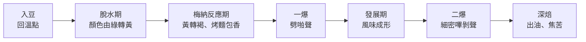

<callout icon="🎯" color="brown_bg">
<b>學習目標</b>

- 理解烘焙過程中豆子發生的物理與化學變化
- 看懂烘焙曲線，知道各階段如何影響風味
- 能依烘焙度挑選適合的沖煮方式，並正確養豆與保存
</callout>

## 1. 為什麼要烘焙

你熟悉的咖啡香，幾乎都是烘焙後才出現的。

生豆堅硬、帶青草與豆類氣味，幾乎沒有我們熟悉的咖啡香。烘焙透過加熱，讓生豆中的糖、胺基酸、有機酸、脂質發生數百種化學反應。研究文獻累計已在烘焙咖啡中鑑定出<b>超過一千種揮發性化合物</b>，其中真正明顯影響香氣的只是一小部分。

所以同一支生豆，不同烘焙可以喝起來像完全不同的咖啡。

## 2. 烘焙的階段

豆子在鍋裡會依序經過幾個看得到、聽得到的階段。認識它們，你才看得懂後面的化學反應和烘焙曲線。

表中溫度是常見參考值，不同來源常相差 5 到 10°C。

| 階段 | 豆溫（大約，依機器與探針位置不同） | 發生什麼 |
| --- | --- | --- |
| 入豆與回溫點 | 入豆後豆溫讀數先下降再回升 | 冷的豆子吸熱，讀數最低點稱為回溫點（turning point） |
| 脫水期（乾燥期） | 到約 150°C | 生豆含水率一般約 10 至 12%，水分蒸發，顏色由綠轉黃，出現青草、稻草、烤吐司前兆氣味 |
| 梅納反應期 | 約 150°C 到一爆 | 糖與胺基酸反應產生褐色物質與大量香氣（烤麵包、堅果、焦糖）；焦糖化也開始 |
| 一爆（First Crack） | 約 195 至 205°C | 豆內水蒸氣與二氧化碳壓力使細胞壁破裂，發出類似爆米花的劈啪聲，體積膨脹 |
| 發展期（Development） | 一爆開始到下豆 | 風味平衡在此決定：酸、甜、苦的比例與香氣的成熟度 |
| 二爆（Second Crack） | 約 220 至 230°C | 細胞結構進一步崩解，聲音細密，油脂開始滲出表面，烘焙味與苦味主導 |

「下豆」是把豆子倒出烘豆機、結束烘焙的那一刻，它決定了第 4 節的烘焙度。

## 3. 關鍵化學反應

淺焙為什麼酸亮、深焙為什麼苦甜？答案在烘焙中同時進行的幾組反應。

<b>梅納反應（Maillard Reaction）</b>是還原糖與胺基酸的反應，和煎牛排表面變褐是同一件事。它產生褐色的類黑素與吡嗪、呋喃等香氣分子，帶來烤麵包、堅果、烘烤香。

<b>焦糖化（Caramelization）</b>是糖自身受熱分解，產生焦糖、楓糖香，過度則轉為苦味。生豆中的蔗糖在烘焙中大量消耗，常見的說法是烘得越深，甜感先升後降。

有機酸的變化決定酸的樣貌。<b>綠原酸（Chlorogenic acid）</b>是生豆中含量很高的一類酸，烘焙時分解成奎寧酸、咖啡酸與帶苦味的綠原酸內酯，讓咖啡的酸從「明亮」轉向「澀、苦」。帶果酸感的檸檬酸、蘋果酸也在烘焙中逐漸減少。

<b>史崔克降解（Strecker Degradation）</b>是梅納反應的分支，胺基酸轉成醛類，貢獻許多香氣。

烘焙還會產生大量二氧化碳（CO2）保留在豆內，之後緩慢釋放。這是「養豆」與「悶蒸」（沖煮前先倒少量水讓粉排氣）的原因。

咖啡因則相當穩定，不因烘焙深淺有顯著變化（極深焙後段可能略有損失）。但深焙豆較輕，若以體積（湯匙）計量，深焙豆咖啡因反而較少。

## 4. 烘焙度

下豆越晚，上一節的反應走得越遠。下表方便你買豆時對照標籤。

| 烘焙度 | 常見說法 | 下豆時機 | 風味特徵 | 適合 |
| --- | --- | --- | --- | --- |
| 極淺焙 | Light, Cinnamon | 一爆剛開始或密集時 | 酸強、花果香，發展不足會有青草、穀物、生豆味 | 杯測、北歐風格手沖 |
| 淺焙 | Light, City（美式用語） | 一爆結束前後 | 明亮酸質、花香、果香、茶感 | 手沖、單品 |
| 中焙 | Medium, City+ | 一爆結束後、二爆前 | 酸甜平衡、焦糖、堅果 | 手沖、義式單品 |
| 中深焙 | Full City | 接近二爆 | 甜感與醇厚提高、巧克力、酸降低 | 義式、加奶飲品 |
| 深焙 | Full City+、Vienna、French | 二爆中 | 苦甜巧克力、煙燻、焦糖化，產地特色減弱，表面出油 | 傳統義式、冰咖啡、法式濾壓 |
| 極深焙 | Italian、French（歐式） | 二爆後期 | 強烈焦苦、炭燒，油亮 | 特定傳統飲法 |

名稱沒有統一標準，所以業界也用儀器與對照表：

- <b>Agtron 數值</b>：以近紅外線量測咖啡粉或豆子的顏色，數字越高越淺（例如 80 以上很淺、40 以下很深），是業界客觀比較烘焙度的工具。Agtron 有 Gourmet 與 Commercial 兩種量表，數字不能直接互換。
- 日式八段烘焙名稱（Light、Cinnamon、Medium、High、City、Full City、French、Italian）在台灣很常見，與美式用語的對應不一致。例如日式的 City 是第五段，通常歸為中深焙，比上表美式的 City 深。看到標籤寫 City，最好以豆色或店家說明為準。

## 5. 烘焙曲線

烘焙度是「烘到哪裡」，曲線是「怎麼烘到那裡」，路徑不同味道也不同。

現代烘焙師用軟體（例如 Artisan、Cropster）記錄豆溫隨時間的變化，並觀察<b>升溫速率 RoR（Rate of Rise）</b>，也就是每分鐘豆溫上升多少度。豆溫像開車走了多遠，RoR 像當下的車速。

### 常見原則

- RoR 平穩遞減：理想的曲線通常讓 RoR 逐步下降，避免一爆後突然「暴衝（flick）」或「驟降（crash）」。暴衝可能帶來焦苦，驟降常造成平淡、烤焙味（baked）。這套主張以烘焙顧問 Scott Rao 最具代表性，也有烘焙師認為影響沒那麼大。
- <b>發展時間比（DTR, Development Time Ratio）</b>：一爆到下豆的時間佔總烘焙時間的比例。Scott Rao 提出的參考值是 20 至 25%，實務上常見約 15 至 25%。太短容易發展不足（青澀、酸澀），太長容易烘焙味過重。
- 總時間：常見大約 8 至 14 分鐘。過快可能外熟內生，過慢可能平淡無味。
- 這些都是經驗法則而非定律，近年也有烘焙師刻意挑戰（例如非常快速的淺焙），最終以杯測（用固定程序品嚐評分）為準。

### 常見烘焙瑕疵

曲線走偏會直接反映在杯子裡，喝到怪味時可用下表回推。

| 瑕疵 | 原因 | 杯中表現 |
| --- | --- | --- |
| 發展不足（Underdeveloped） | 一爆後太快下豆或熱量不足 | 青草、穀物、花生皮、尖銳酸澀 |
| 烤焙味（Baked） | RoR 在後段停滯或過慢 | 平淡、紙板、麵包、缺乏甜感與酸質 |
| 焦面（Scorching） | 初期溫度太高（入豆溫度過高、豆量相對熱量太少）、翻攪不足 | 豆表面有焦斑，帶焦苦 |
| 尖端焦黑（Tipping） | 熱量過高、升溫太快使豆尖燒焦 | 焦苦 |
| 烘焙不均 | 豆子大小密度不均、攪拌不佳 | 雜味，風味不集中 |

## 6. 烘豆機

曲線能怎麼走，也取決於烘豆機怎麼把熱傳給豆子，這是各家風格差異的來源之一。

| 類型 | 加熱方式 | 特色 |
| --- | --- | --- |
| 直火式 | 鍋爐有孔，火焰直接接觸豆子 | 風味奔放、個性強，但較難控制，日本深焙店家常用 |
| 半熱風式 | 鍋爐無孔，傳導加熱加上熱風 | 最普遍，平衡易控制（例如許多商用滾筒機） |
| 熱風式 | 完全以熱風加熱，豆子在氣流中翻滾 | 乾淨明亮、均勻，常見於淺焙 |
| 家用 | 手網、陶鍋、小型電熱機 | 入門實驗，控制度較低 |

熱傳遞有三種方式：<b>傳導</b>（接觸鍋爐，像平底鍋煎）、<b>對流</b>（熱空氣，像氣炸鍋）、<b>輻射</b>（高溫鍋壁與火焰）。不同機器比例不同，風格也不同。分類界線並不絕對，現代直火機也會抽熱風通過滾筒。

## 7. 配方豆與單品

買豆時你會看到「單品」和「配方」，兩者的目的不同。

<b>單品（Single Origin）</b>來自單一產地，甚至單一莊園或批次，展現產地特色。

<b>配方豆（Blend）</b>由多支豆子混合，追求穩定與平衡，常用於義式。可以先混再烘（風味融合、方便），或分開烘再混（每支豆子用最適合的烘焙）。

配方設計常見的分工：

- 一支負責骨架，例如巴西，提供醇厚與堅果巧克力
- 一支負責甜感，例如中美洲
- 一支負責亮點，例如衣索比亞，提供花果香

## 8. 養豆與保存

豆子烘好後風味還在變，所以要知道等多久再喝、怎麼存。

烘焙後的豆子持續釋放 CO2。太新鮮的豆子沖煮時氣體多，會干擾萃取，讓味道不穩定。

- <b>養豆（Resting）</b>參考：手沖用淺焙豆常建議約 5 至 14 天後風味較穩定；義式用豆常建議約 7 至 21 天；深焙豆通常較快進入賞味期。實際以自己的豆子測試為準。
- 保存：避光、隔氧、避熱、避濕。使用單向排氣閥袋（只讓氣體出去、不讓空氣進來）或密封罐。
- 冷凍：分裝成單次用量，密封後冷凍可延長保存；取出後不要回凍，可直接研磨。2016 年《Scientific Reports》的研究發現豆溫越低，研磨粒徑分布越集中。
- 磨成粉後，豆子原本要花幾週釋放的氣體會在幾分鐘內大量逸散，香氣跟著快速流失，所以要現磨現沖。

### 咖啡豆為什麼會不新鮮

這段回答：豆子放久了，到底是什麼在變？

烘焙過的咖啡在食品科學上屬於常溫下不易腐壞的食品，放久了通常不是因為微生物而壞掉，而是風味慢慢變差，業界稱為<b>走味（staling）</b>。SCA 在 2012 年整理的文獻回顧，把影響走味速度的因素歸納如下：

- <b>氧氣</b>：被視為最主要的因素。香氣分子很容易氧化流失，豆子裡的油脂氧化後還會產生油耗味。文獻回顧引用的研究指出，把包裝內的氧氣降到 0.5%，保存期限可延長約 20 倍。
- <b>溫度</b>：溫度越高，所有化學反應都越快。不同研究測得的數字不同，大約是每升高 10°C，排氣速度增加 1.5 到 2 倍。
- <b>水分</b>：環境越潮濕，豆子吸收的水分越多，香氣流失越快。
- <b>二氧化碳流失</b>：CO2 會把香氣帶出豆子；同時，只要豆子周圍還有 CO2，氧氣就比較難進來。SCA 的說明是，CO2 散掉之後，空氣會取而代之，咖啡開始出現不好的味道。

走味的速度並不平均。瑞士蘇黎世應用科學大學（ZHAW）用精密秤追蹤整豆的排氣，發現烘焙後約前 20 天排氣最快，之後明顯變慢，而且淺焙豆排氣比深焙豆慢。SCA 文獻回顧引用的研究也指出，香氣流失最劇烈的是儲存的頭幾天，新鮮感下降最快的是第一個月。

常見的保存建議還有<b>避光</b>。上述 SCA 文獻回顧沒有討論光線的影響，所以這一點是普遍的做法，這裡沒有具體數字可以提供。

### 整豆和咖啡粉差多少

這段回答：買咖啡粉比較方便，但會差多少？

研磨後表面積大增，排氣和走味都跟著加速。SCA 文獻回顧引用的研究測得，溫度升高時，咖啡粉走味加速的幅度約是整豆的兩倍。SCA 的專欄 Coffee Decoded 以 CO2 排氣當指標，給了一個概略的標準：整豆在烘焙後約三週內可以算新鮮，咖啡粉大約只有研磨後一小時。

這兩個時間是用排氣速度推算的參考，不是喝了會出問題的期限。實際上的意思是：能買豆子自己磨就不要買粉；一定要買粉，就買小包裝，開封後盡快用完。

### 冰箱還是冷凍庫

這段回答：豆子可以放冰箱嗎？

研究支持的是<b>冷凍</b>，冷藏則缺少直接證據。SCA 文獻回顧指出，多數把冷藏或冷凍列入比較的研究都發現低溫能減緩走味反應，但這些研究都沒有量測冷凍本身或溫度反覆變化帶來的差異。

- <b>冷凍的證據</b>：ZHAW 與 SCA 的研究比較 35°C 與 −25°C 保存，冷凍明顯減緩了排氣。2018 年美國賓州州立大學的研究把整豆分別放在 −20°C 與 25°C 九週，請 48 位消費者只用聞的評比：深焙豆冷凍後和新鮮豆差異很小，常溫保存的則被明顯區分出來；淺焙豆在兩種條件下差異都不大。這項研究只用了一批豆子，也只評香氣。
- <b>冷凝水</b>：從冷凍庫拿出的冷豆子碰到溫暖潮濕的空氣，表面可能凝結水氣，而水分會加速走味。賓州州立大學的研究者表示，在文獻中沒有找到冷凝造成問題的證據。保險的做法仍是分裝成單次用量、密封後冷凍，取出的那一份就用完，不要回凍。
- <b>冷藏</b>：冰箱的溫度不如冷凍庫低，又常開關，還有其他食物的氣味。常見的說法是咖啡會吸附冰箱異味，這一點目前沒有找到研究數據，一般不建議把冷藏當成長期保存的方法。

前面提到的 2016 年《Scientific Reports》研究，量測的是不同豆溫下研磨的粒徑分布，不是冷凍保存對風味的影響，兩件事要分開看。

### 包裝上的單向閥與充氮

這段回答：咖啡袋上那個小圓孔是什麼？

剛烘好的豆子會持續排出 CO2，完全密封的袋子會被撐脹，所以咖啡袋常裝<b>單向排氣閥</b>，讓氣體出去、不讓外面的空氣進來。ZHAW 的研究發現，在有閥的袋子裡，烘焙後第一週排出的 CO2 會把袋內的氧氣推出去，袋內 CO2 濃度常可達約 80%，能部分減緩氧化。

另一種做法是<b>充氮</b>或真空包裝，封口前用氮氣置換或抽掉袋內的空氣。SCA 文獻回顧引用的研究中，充氮包裝的咖啡粉以感官評估的保存期限約 6 個月，未充氮的約 3 個月；另一項研究則發現真空包裝的走味速度約為一般空氣包裝的五分之一。不過，專門比較各種包裝的研究其實很少。

包裝保護的是未開封的狀態。開封後空氣進入，走味會加速，文獻稱為開封後的「第二段保存期限」。開封後把袋內空氣擠出、封好袋口，放在陰涼乾燥處。

### 看懂包裝上的日期

這段回答：袋子上的「有效日期」和「烘焙日期」差在哪？

台灣《食品安全衛生管理法》第 22 條規定，食品的容器或外包裝必須標示<b>有效日期</b>；施行細則第 13 條規定要標明年月日，保存期限在三個月以上的可以只標年月，以當月最後一天為止。同法第 15 條規定，逾有效日期的食品不得販賣。法規並沒有要求標示烘焙日期。

所以你在袋子上可能看到兩種日期：

| 日期 | 由誰決定 | 告訴你什麼 |
| --- | --- | --- |
| 有效日期 | 法規要求標示，期限由廠商訂定 | 過了這天就不能販賣。期限通常比風味最好的時段長很多 |
| 烘焙日期 | 店家自行標示 | 豆子哪天烘好，用來估算養豆天數和新鮮程度 |

想喝到香氣，看烘焙日期比看有效日期準。把上面的資料放在一起：烘焙後先依本節開頭的養豆建議等幾天，整豆排氣在前三週左右最活躍，之後風味變化變慢、香氣也逐漸變淡。袋子上只有有效日期時，可以直接問店家烘焙日期。

## 9. 在家嘗試烘焙

想自己動手，重點是記錄與比較。

1. 用手網或小型烘豆機，選擇價格合理、密度高的水洗中美洲豆開始
2. 記錄：投豆量、火力、每 30 秒的豆溫（若有溫度計）、一爆開始時間、下豆時間
3. 下豆後快速冷卻（用風扇或篩網），避免餘溫繼續烘
4. 同一支豆子烘三個深度（一爆結束、一爆後 1 分鐘、接近二爆），養豆後做杯測比較
5. 注意安全：銀皮（豆表脫落的薄膜）易燃，注意排煙與通風

## 參考資料

- [Single Origin Coffee Aroma（Molecules 2021）](https://pmc.ncbi.nlm.nih.gov/articles/PMC8346979)：已鑑定超過一千種揮發性化合物，僅少數可被嗅覺察覺
- [Perfect Daily Grind：生豆含水率](https://perfectdailygrind.com/2017/08/roaster-guide-why-is-green-bean-moisture-content-important/)：含水率一般接受範圍 10 至 12%
- [Agtron M-Basic II 手冊](https://static1.squarespace.com/static/5d77ebfe1fc5e024160b28c5/t/5ee91d0345641c11725cbfb8/1592335620543/m-basic+ii+om++++++++.pdf)：以近紅外線量測，分 Gourmet 與 Commercial 量表
- [珈琲豆研究所：シティロースト](https://coffee-labo.co.jp/cityroast)：日式八段中 City 為第五段，屬中深焙以上
- [Daily Coffee News：咖啡因與烘焙度](https://dailycoffeenews.com/2024/11/26/do-light-roasts-or-dark-roasts-have-more-caffeine-study-maybe-medium)：咖啡因在烘焙中大致穩定，計量方式影響含量
- [Effect of roasting on chlorogenic acid lactones（FAO AGRIS）](https://agris.fao.org/search/ru/records/65df5c1bb766d82b18017049)：烘焙使綠原酸形成內酯
- [Scott Rao：Development Time Ratio](https://scottrao.com/blog/2016/8/25/development-time-ratio)：DTR 20 至 25% 的參考值與限制
- [Cropster：The Flick, Updated for 2021](https://www.cropster.com/blog-post/the-flick-updated-for-2021/)：RoR 平穩遞減與一爆後暴衝、驟降
- [Uman et al.（Scientific Reports 2016）](https://pmc.ncbi.nlm.nih.gov/articles/PMC4834475)：豆溫越低，研磨粒徑分布越窄
- [Loring：Avoiding Roasting Defects](https://loring.com/wp-content/uploads/2020/11/Loring-Tech-Paper-Avoiding-Roasting-Defects-1010764-RevA.pdf)：焦面與尖端焦黑的成因
- [What is the Shelf Life of Roasted Coffee? A Literature Review on Coffee Staling（SCA，2012）](https://sca.coffee/sca-news/2012/02/15/what-is-the-shelf-life-of-roasted-coffee-a-literature-review-on-coffee-staling-bjcx7)：氧氣、溫度、水分對走味的影響，氧氣 0.5% 延長約 20 倍、Q10 1.5、咖啡粉約為整豆兩倍、冷凍研究的限制、充氮 6 個月對 3 個月、真空包裝約五分之一的走味速度
- [Coffee Decoded: What is "freshly roasted" coffee?（SCA）](https://sca.coffee/sca-news/coffee-decoded-9-fresh-coffee)：整豆前 20 天排氣最快、CO2 阻擋氧氣、整豆約三週與咖啡粉約一小時的新鮮參考
- [Preserving Freshness: A Race Against Time（SCA 25 Magazine Issue 4）](https://sca.coffee/sca-news/25-magazine/issue-4/preserving-freshness-race-time-25-magazine-issue-4-2spkp)：每升高 10°C 排氣約加倍、淺焙排氣較慢、閥袋內 CO2 約 80%、35°C 與 −25°C 的冷凍比較
- [Time-Resolved Gravimetric Method To Assess Degassing of Roasted Coffee（ZHAW 典藏）](https://digitalcollection.zhaw.ch/handle/11475/12175)：ZHAW 以重量法量測整豆與咖啡粉的排氣
- [Wake up and smell the coffee: Research shows freezing beans can preserve aroma（賓州州立大學）](https://www.psu.edu/news/research/story/wake-and-smell-coffee-research-shows-freezing-beans-can-preserve-aroma)：−20°C 與常溫保存 9 週的香氣比較、冷凝問題缺乏文獻證據
- [The Effects of Storage Temperature on the Aroma of Whole Bean Arabica Coffee（Beverages 2018）](https://mdpi.com/2306-5710/4/3/68)：48 位消費者、深焙與淺焙的冷凍保存結果
- [食品安全衛生管理法第 22 條（全國法規資料庫）](https://law.moj.gov.tw/LawClass/LawSingle.aspx?pcode=L0040001&flno=22)：包裝食品須標示有效日期
- [食品安全衛生管理法施行細則第 13 條（全國法規資料庫）](https://law.moj.gov.tw/LawClass/LawSingle.aspx?pcode=L0040003&flno=13)：有效日期標明年月日，三個月以上可只標年月
- [食品安全衛生管理法第 15 條（全國法規資料庫）](https://law.moj.gov.tw/LawClass/LawSingle.aspx?pcode=L0040001&flno=15)：逾有效日期不得販賣

## 自我檢核

<callout icon="💬" color="gray_bg">
先自己回答，再展開參考答案。
</callout>

<toggle>
Q1 一爆是怎麼發生的？

豆內水分變成水蒸氣，加上化學反應產生的二氧化碳，使豆內壓力上升。當壓力超過細胞壁強度時細胞破裂，發出類似爆米花的劈啪聲，豆子體積膨脹。通常在豆溫約 195 至 205°C 時發生（依機器與探針不同）。
</toggle>

<toggle>
Q2 梅納反應與焦糖化有什麼不同？

梅納反應是還原糖與胺基酸之間的反應，產生褐色物質與烤麵包、堅果等複雜香氣；焦糖化是糖類自身受熱分解，產生焦糖、楓糖香，過度則變苦。兩者在烘焙中同時發生，但參與物與產物不同。
</toggle>

<toggle>
Q3 為什麼深焙咖啡通常酸感較低、苦味較明顯？

烘焙越深，檸檬酸、蘋果酸等有機酸逐漸分解；綠原酸分解產生帶苦澀的化合物（例如綠原酸內酯）；糖類過度焦糖化轉為苦味；同時烘焙味與煙燻香主導，掩蓋產地的果酸與花香。
</toggle>

<toggle>
Q4 什麼是 RoR？為什麼烘焙師關心它？

RoR 是升溫速率，也就是每分鐘豆溫上升多少度。它反映熱量輸入是否平穩。一般希望 RoR 平穩遞減，避免一爆後暴衝（容易焦苦）或驟降（容易平淡、烤焙味）。它是分析與重現烘焙的重要工具，但仍需以杯測驗證。
</toggle>

<toggle>
Q5 喝到一支咖啡有明顯的青草、花生皮味與尖銳酸澀，可能是什麼烘焙問題？

很可能是發展不足：一爆後太快下豆或熱量不足，糖與酸沒有充分轉化。可以延長發展時間或提高後段熱量，讓 RoR 平穩地走完發展期。
</toggle>

<toggle>
Q6 深焙豆的咖啡因比淺焙豆多嗎？

咖啡因在烘焙中相當穩定，以重量計兩者差異不大。深焙豆因失水與膨脹而較輕、體積較大，若用湯匙（體積）計量，同一匙深焙豆重量較少，咖啡因反而略少。所以「深焙比較提神」是誤解。
</toggle>

<toggle>
Q7 為什麼剛烘好的咖啡不一定最好喝？

剛烘好的豆子含有大量二氧化碳，沖煮時氣體會阻礙水與粉的接觸，萃取不穩定，風味也可能帶刺激感。經過幾天到兩三週的養豆，氣體釋放、風味趨於穩定，通常更好喝。確切天數依烘焙度與沖煮方式而異。
</toggle>

<toggle>
Q8 設計一支義式配方豆，你會怎麼搭配？

照第 7 節的分工來搭：一支負責骨架，例如巴西，提供醇厚與堅果巧克力；一支負責甜感，例如中美洲；一支負責亮點，例如衣索比亞，提供花果香。再決定要先混再烘，還是分開烘再混，讓每支豆子用最適合的烘焙。各支的比例沒有固定答案，透過多次萃取與杯測微調。
</toggle>

<toggle>
Q9 咖啡豆可以冷凍嗎？要注意什麼？

可以。建議分裝成單次用量、密封以隔絕濕氣與異味後冷凍；取出時整包使用，不要反覆解凍回凍，以免冷凝水進入。可以直接從冷凍研磨，有研究發現豆溫越低、研磨粒徑分布越集中。
</toggle>

<toggle>
Q10 直火式與熱風式烘豆機風味上有什麼傾向？

直火式讓火焰直接接觸豆子，輻射熱多，風味奔放、厚實、個性強，但較難控制；熱風式以熱空氣加熱，豆子受熱均勻，風味傾向乾淨明亮，常用於淺焙。半熱風式介於兩者之間，是最普遍的商用機型。
</toggle>
