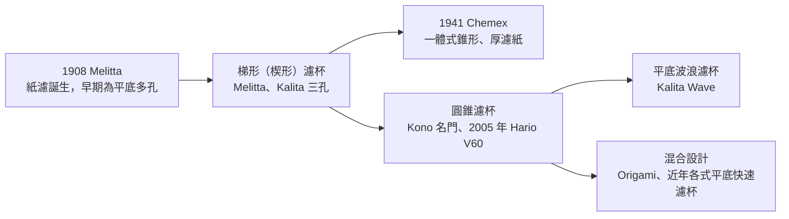

<callout icon="🎯" color="brown_bg">
<b>學習目標</b>

- 理解萃取原理：萃取率、濃度與它們如何決定味道
- 熟悉主流手沖器材與各自的特性
- 掌握幾套經典手沖配方，並能依味道問題調整參數
</callout>

## 1. 萃取原理

同一包豆子，有時沖出來酸得皺眉，有時苦得難以入口，差別往往不在豆子，而在「從粉裡溶出了什麼、溶出了多少」。這一節先講清楚萃取在做什麼，後面所有的器材、配方與調整，都是在控制這件事。

### 咖啡粉裡有什麼可以被萃取

萃取，就是熱水把咖啡粉裡的風味物質溶解帶走的過程，有點像泡茶時茶葉的味道慢慢跑進水裡。

烘焙後的咖啡粉，大約只有 30%（研究測得約 28 至 32%）的重量是水可以溶出的物質，其餘是纖維素等不可溶的骨架。你不需要、也不應該把可溶物全部萃出，因為最後才溶出的物質多半苦澀。

### 萃取順序

可溶物不是一起出來的，不同物質溶出的速度不同，大致順序是：

1. <b>酸</b>與果香類：分子小、易溶，最快溶出
2. <b>甜</b>：糖與焦糖化產物
3. <b>苦</b>與澀：分子較大、溶出較慢，過度萃取時大量出現

因為有這個先後，萃取停在哪個階段，味道就落在哪裡。萃取不足時，酸先出來、甜還沒跟上，喝起來偏酸、薄、帶鹹味、尾韻短；萃取過度時，後段的苦澀物質大量進來，喝起來苦、澀、口腔發乾、中段空洞。萃取剛好，則是酸甜平衡、有甜感與長尾韻。

### 兩個關鍵數字

要把「剛好」說得更精確，咖啡業界用兩個數字描述一杯咖啡：一個講味道的組成，一個講味道的強弱。

下表的 SCA 是精品咖啡協會（Specialty Coffee Association）；「金杯」是 SCA 用萃取率與濃度訂出的理想沖煮參考範圍，是方向，不是唯一的好喝。

| 指標 | 定義 | SCA 金杯參考範圍 | 對應感受 |
| --- | --- | --- | --- |
| <b>萃取率（Extraction Yield, EY）</b> | 從咖啡粉中溶出的物質佔粉重的百分比 | 約 18 至 22% | 「味道的組成」：酸甜苦的比例 |
| <b>濃度（TDS, Total Dissolved Solids）</b> | 咖啡液中溶解物質佔液體重量的百分比 | SCA 金杯標準約 1.15 至 1.35%；歐洲版控制圖約 1.30 至 1.55%（不同地區偏好不同） | 「味道的強弱」：濃或淡 |

SCA 制定了許多業界通用的沖煮與品質標準。TDS 一般用折射計（refractometer）測量，這是一種滴幾滴咖啡液就能讀出濃度的儀器。

<b>計算方式</b>：萃取率 = TDS × 咖啡液重量 ÷ 咖啡粉重量。

例：15g 咖啡粉，得到 225g 咖啡液，用折射計量到 TDS 1.35%，則萃取率 = 1.35% × 225 ÷ 15 ≈ 20.3%。

這兩個數字由不同的參數主導。濃度主要由<b>粉水比</b>決定；萃取率主要由研磨、水溫、時間、擾流（攪拌、搖晃、注水力道這類讓水和粉翻動的動作）決定。粉水比是咖啡粉與水的重量比例：1:16 就是 1g 粉配 16g 水，所以 15g 粉要配 240g 水。所以「太淡」要加粉，「太酸」要讓萃取更充分，兩者是不同的調整方向，不要混在一起。

## 2. 六大變數

知道了萃取率與濃度，下一個問題是：手上有哪些旋鈕可以轉？沖煮時你能控制的變數大致有六個，每一個都會改變你在杯中喝到的味道。

| 變數 | 對萃取的影響 | 建議起點 |
| --- | --- | --- |
| <b>研磨度</b> | 越細，表面積越大、流速越慢，萃取越多。最常用也最有效的調整 | 手沖約粗砂糖到海鹽的顆粒 |
| <b>粉水比</b> | 主要決定濃度 | 1:15 至 1:17 |
| <b>水溫</b> | 越熱萃取越快越多 | 淺焙 92 至 96°C；中焙 88 至 92°C；深焙 82 至 88°C（SCA 家用沖煮機標準要求約 90 至 96°C） |
| <b>時間</b> | 接觸時間越長萃取越多 | 單杯手沖總時間約 2:30 至 3:30 |
| <b>擾流（攪拌、注水力道、搖晃）</b> | 越強萃取越快，也影響均勻度 | 保持一致比強弱更重要 |
| <b>水質</b> | 礦物質（鎂、鈣）幫助萃取風味；碳酸氫鹽（鹼度）中和酸，過高會讓咖啡平淡 | 見下節 |

### 水質

六個變數裡，水質最常被忽略。一杯手沖超過 98% 是水，水裡的礦物質會影響哪些風味被萃出，也會中和咖啡的酸。SCA 的水質標準大致如下（mg/L 與 ppm 在這裡可視為相同）：

- 總溶解固體：目標 150 ppm，可接受範圍 75 至 250 ppm
- 鈣硬度：目標 68 ppm，可接受範圍約 17 至 85 ppm
- 總鹼度：約 40 ppm
- pH：目標 7.0，範圍 6.5 至 7.5
- 鈉：約 10 ppm；無氯、無異味

實務上，台灣不少地區的自來水經過濾水器去除氯味後就能用，但各地硬度差異很大，見下一段。純水（RO 水，經逆滲透去除幾乎所有礦物質的水）太「空」，容易萃取不足、風味扁平，可以加入市售的咖啡礦物質包自己調水。市售礦泉水的礦物質組成差異很大，拿同一支豆子比較幾種水，是很能體會水質影響的實驗。

### 在台灣家裡用什麼水

這段回答：上面那些標準數字，對照到你家的水龍頭是什麼意思？

<b>先看懂數字。</b>SCA 標準寫的是<b>鈣硬度</b>，只算鈣；自來水單位公布的多半是<b>總硬度</b>，鈣和鎂一起算。兩者不能直接畫上等號，但總硬度可以讓你抓個大概：總硬度很低的水，鈣硬度也不會高。台灣自來水公司第十二區管理處的水質參數說明（2025 年更新）把硬度分成軟水 0 至 75 mg/L、中等硬水 75 至 150、硬水 150 至 300、極硬水 300 以上，都以碳酸鈣計；環境部《飲用水水質標準》第 3 條的總硬度上限是 300 mg/L（以碳酸鈣計）。

<b>台灣的自來水有多硬？</b>答案是看地區，主要取決於水源是河川、水庫還是地下水：

- 大臺北：臺北自來水事業處的常見問答（2023 年 8 月更新）說明，以新店溪為水源的長興、公館、直潭淨水場佔出水量 97.5%，總硬度都低於 50 mg/L；高地供水區除了陽明山第三湧泉水源約 150 mg/L，其餘都低於 100 mg/L。同一頁的對照表列出市區平地約 30 至 40 mg/L，北投區中山北路 7 段附近的陽三水源 140 至 150 mg/L。
- 台灣自來水公司各淨水場公布的平均水質：新北板新淨水場總硬度 74.4 mg/L，高雄鳳山淨水場 139 mg/L（兩者都是 2026 年 11 月 11 日發布）。這些數字每期更新，會隨季節和水源調度變動；同一個縣市裡，不同淨水場的數字也可能相差很多。

對照 SCA 鈣硬度的可接受範圍約 17 至 85 ppm：大臺北的自來水偏軟，落在範圍內或偏低處；總硬度超過 150 mg/L 的地區，鈣硬度很可能超出建議範圍，沖出來的咖啡可能較平淡，水壺也容易結垢。你家的水以所在地自來水單位公布的水質資料為準：台灣自來水公司官網的「平均水質」可以依淨水場查詢，大臺北地區看臺北自來水事業處。

<b>濾水器和 RO 做了什麼？</b>

- <b>活性碳濾芯</b>：臺北自來水事業處說明，活性碳初期可以有效去除水中餘氯與有機物，也就是改善氯味。
- <b>軟化型濾水器</b>：臺北自來水事業處提到，軟化濾水器會讓水中的鈉增加。SCA 標準的鈉約 10 ppm，所以軟水器出來的水不一定適合沖咖啡。
- <b>RO 逆滲透</b>：幾乎去除所有礦物質，沖咖啡容易平淡，需要自己加礦物質調水。至於拿來喝，衛福部食藥署說明，一般人的礦物質主要來自食物，均衡飲食下不會因為長期喝 RO 水或純水而缺乏礦物質；個人狀況請諮詢醫師。
- 臺北自來水事業處也提醒，經過活性碳或 RO 處理的水不再有消毒能力，不宜在濾芯、管線或容器裡久放。

<b>煮沸會改變什麼？</b>臺北自來水事業處說明，自來水中的礦物質主要是碳酸氫鈣，煮沸後會形成碳酸鈣，也就是水垢。所以硬度越高的水，煮過後水壺越容易結垢。想去除餘氯的氣味，台灣自來水公司的常見問答建議可以掀蓋煮沸數分鐘，或用活性碳過濾。

## 3. 器材

變數要能被穩定控制，靠的是器材。這一節先介紹每個人都需要的基本工具，再認識各式濾杯與沖煮器，了解它們的結構如何影響你喝到的味道。

### 新手的器材順序

這段回答：一次買不齊，先買什麼？

依照這一篇前面的原理，最常用也最有效的調整是研磨，其次是量準粉和水，再來才是注水控制。照這個邏輯排序：

1. <b>刀盤式磨豆機</b>：研磨度和均勻度直接決定萃取，也讓你能現磨，避免咖啡粉快速走味
2. <b>電子秤（0.1g、可計時）</b>：粉水比決定濃度，時間影響萃取，沒有秤就無法重現配方或做紀錄
3. <b>濾杯與濾紙</b>：先選容錯高的平底濾杯或浸泡式濾杯，對注水手法的要求較低
4. <b>細口手沖壺</b>：讓水流粗細和落點穩定，用圓錐濾杯時特別重要；如果先用浸泡式濾杯，可以晚一點買
5. <b>可以等的</b>：溫控壺（或一支溫度計）、折射計、各式新濾杯。要確實做到配方的水溫，可靠的做法是用溫控壺或溫度計確認；把煮沸的水稍放涼只能抓個大概，還沒買之前可以先這樣替代。沒有折射計，也可以用第 10 節的感官方法判斷萃取

### 基本工具

- <b>細口手沖壺</b>：控制水流粗細與落點，有溫控功能的更方便
- <b>電子秤</b>：精度 0.1g、有計時功能
- <b>磨豆機</b>：影響最大的器材，見下段說明
- <b>濾紙</b>：分漂白與未漂白，未漂白的需先充分沖洗去紙味

磨豆機值得多說一句。決定萃取是否一致的是<b>研磨均勻度</b>：顆粒大小不一，細的過度萃取、粗的萃取不足；細粉過多還會帶來苦澀並阻塞濾紙。刀盤分錐刀與平刀，常見的說法是平刀粒徑分布較集中、風味清晰，錐刀口感較厚實，下一段說明這些說法有多少根據。

### 磨豆機怎麼選

這段回答：磨豆機種類那麼多，新手該看什麼？

先回到第 1 節的原理。可溶物溶出的速度和顆粒大小有關：細的顆粒表面積大，很快就萃取過度；粗的顆粒萃取得慢，容易不足。所以磨豆機的任務不只是磨細，而是讓顆粒<b>大小接近</b>。實際量測時，磨出來的咖啡粉不會是單一尺寸。2016 年《Scientific Reports》的研究量測了不同豆溫下研磨的粒徑分布，發現豆溫越低分布越窄。2020 年發表在《Matter》的義式濃縮研究則發現，研磨細到某個程度以下，水在粉層中的流動變得不均勻，萃取率反而下降，每杯之間的差異也變大，研究者把原因指向過細的顆粒堵住水流通道。這和第 6 節排查表裡「細粉堵塞」「又酸又苦」的道理相同。

<b>刀片式與刀盤式</b>

- <b>刀片式</b>（俗稱砍豆機）用高速旋轉的刀片把豆子打碎，粗細主要取決於打多久。2014 年《Journal of Food Research》的研究測試了刀片式磨豆機，發現研磨時間會改變粒徑分布與沖出來的咖啡成分；文中也指出刀片式的粒徑分布通常很寬，刀盤式較容易控制、一致性較高。
- <b>刀盤式</b>用兩片刀盤把豆子磨碎，刀盤之間的距離決定粗細，可以用刻度調整。手沖要能穩定地調研磨度，刀盤式是基本條件。

<b>錐刀與平刀</b>

常見的說法是平刀的粒徑分布較集中、風味較清晰，錐刀細粉較多、口感較厚實。這些說法多半來自廠商與愛好者的量測，目前沒有找到同儕審查的研究直接比較兩者在杯中的差異。所以新手不必把錐刀或平刀當成第一個考量。

<b>手搖與電動</b>

兩者都可以是刀盤式，差別在動力。常見的說法是手搖式體積小、不用插電、聲音小，但每次要花一點力氣與時間；電動式省力，適合一次沖多杯的人。這部分是使用經驗的整理，沒有研究數據。

<b>新手可以看這幾點</b>

- 選刀盤式，不選刀片式
- 有明確的刻度或段數，調整後能回到同一個位置，第 8 節的紀錄表才記得下「磨豆機與刻度」
- 能穩定磨出手沖需要的中細到中粗範圍
- 研磨後殘留在機器裡的舊粉會混進下一杯，常見的建議是選容易清潔的款式

### 濾杯與沖煮器

| 器材 | 結構 | 特性 | 故事 |
| --- | --- | --- | --- |
| <b>Melitta</b> | 梯形，底部小孔 | 流速慢，萃取較充分 | 德國德勒斯登的 Melitta Bentz 用兒子作業簿上的吸墨紙鋪在打了孔的黃銅杯裡過濾咖啡，1908 年向帝國專利局登記，成為手沖的起點 |
| <b>Hario V60</b> | 60 度圓錐，螺旋肋紋，底部單一大孔 | 流速主要由注水控制，自由度高，風味明亮乾淨，但對手法敏感 | 日本 Hario 於 2005 年推出（Hario 官方沿革），前身是 1980 年代的圓錐濾杯；名稱取自 V 字形圓錐與 60 度角，是精品手沖最普及的濾杯之一 |
| <b>Kalita Wave</b> | 平底三孔，波浪濾紙 | 粉床平整、萃取均勻、容錯高 | 日本 Kalita 出品，比賽中常見 |
| <b>Kono 名門</b> | 圓錐，肋紋只在下半部 | 上半部濾紙貼壁，適合慢速點滴，口感厚實 | 日本 Kono 出品，與日本喫茶店的點滴手沖文化關係密切 |
| <b>Origami 摺紙濾杯</b> | 摺紙般的深肋紋，可用錐形或波浪濾紙 | 流速快、風格可切換 | 日本美濃燒陶瓷，比賽選手愛用 |
| <b>Chemex</b> | 玻璃一體式，厚濾紙 | 極乾淨、明亮，適合多人份 | 化學家 Peter Schlumbohm 設計，1941 年取得專利，外型常被形容是實驗室錐形瓶加漏斗，被紐約現代藝術博物館收藏 |
| <b>聰明濾杯（浸泡式）</b> | 底部有閥門，先浸泡後放流 | 結合浸泡與過濾，穩定容易上手 | 台灣廠商 ABID 設計，常見說法是 2008 年前後推出，國際上稱 Clever Dripper |
| <b>愛樂壓（AeroPress）</b> | 活塞式，用空氣壓力推出咖啡 | 快速、耐用、配方變化極多，可正放或倒放 | 2005 年由發明家 Alan Adler 推出；2008 年起有世界愛樂壓大賽，選手配方五花八門 |
| <b>法式濾壓壺</b> | 全浸泡，金屬濾網 | 油脂豐富、醇厚，但有細粉 | 十九到二十世紀在法國與義大利演變而成 |
| <b>賽風（虹吸壺）</b> | 利用蒸氣壓力把水推到上壺浸泡，離火後咖啡液被吸回下壺 | 香氣高、乾淨、表演性強 | 十九世紀歐洲發明，在日本與台灣發展出深厚的職人文化 |
| <b>法蘭絨濾布</b> | 以布袋過濾 | 油脂部分保留、口感圓潤如絲 | 日本老派喫茶店的象徵，例如東京銀座的老店以長年堅持的濾布手沖聞名 |

### 近年的新濾杯

大約從 2019 年起，新濾杯的設計朝幾個清楚的方向發展。看出一支新濾杯屬於哪個方向，你就大致知道該怎麼磨、怎麼注水。

<b>浸泡與閥門式（可切換浸泡與滲濾）</b>：底部加一個開關，關上時像聰明濾杯一樣浸泡，打開就變回滲濾。代表是 Hario Switch，等於在 V60 底部加了鋼珠閥門。好處是兼得浸泡的穩定與滲濾的乾淨。浸泡段較長，研磨可比一般 V60 粗一點。

<b>快流速平底</b>：平底讓粉床厚度一致，再用大開口或把濾紙墊高的底部讓水快速流出，例如 April Brewer、Orea、Timemore B75、Fellow Stagg [X]。想要的是平底的均勻，又不被小孔拖慢。因為流得快，通常要磨得比 Kalita Wave 細，注水要輕柔，避免沖亂粉床。

<b>無旁通（zero-bypass）</b>：旁通是指一部分水沒有穿過粉層，而是沿著濾紙或粉層上方的空隙直接流進咖啡液。無旁通濾杯讓水只能從粉層中通過，例如 Tricolate 與 NextLevel Pulsar。好處是每一滴水都參與萃取，但流速慢、容易阻塞，常見做法是研磨放粗，比例也比一般手沖稀一些。

<b>圓錐的新變化與可調流速</b>：圓錐沒有退場，而是在溝紋、角度與出水口上做變化。Hario V60 Mugen 用星形溝紋讓濾紙貼壁、放慢流速，設計成一次注完水，研磨要比平常細；CAFEC 的 Flower Dripper 與 Deep 27 用花瓣狀溝紋與更窄的錐角；December Dripper 旋轉底部墊片就能改變開孔，沖到一半也能調流速。

| 濾杯 | 類型 | 設計重點 | 沖煮上的意義 |
| --- | --- | --- | --- |
| <b>Hario Switch</b> | 浸泡與閥門 | 日本 Hario，2019 年推出；V60 圓錐加鋼珠閥門，用 V60 濾紙 | 可全浸泡、全滲濾或兩者混用 |
| <b>NextLevel Pulsar</b> | 無旁通加閥門 | 約 2023 年推出；附分水蓋與流量閥 | 關閥浸泡、開閥滲濾，濕潤較均勻 |
| <b>Tricolate</b> | 無旁通 | 澳洲 Dan Shusett 設計，2018 年發明；80mm 寬的平坦粉床；後續版本改以 FLOE 為名 | 萃取率容易拉高，但滴濾較慢 |
| <b>April Brewer</b> | 快流速平底 | 丹麥哥本哈根 April；Patrik Rolf 在 2019 年世界手沖大賽用過原型；底部楔形支架墊高濾紙 | 平底的均勻加上快速滴完 |
| <b>Orea</b> | 快流速平底 | 英國倫敦的小品牌，2021 年推出首款；底部開口大、阻力小 | 流速很快，需要較細研磨 |
| <b>Timemore B75</b> | 快流速平底 | 中國 Timemore；75 度側壁加肋紋，用 Kalita Wave 類濾紙 | 入手門檻低的快速平底 |
| <b>Fellow Stagg [X]</b> | 平底 | 美國 Fellow；雙層真空不鏽鋼，專用平底濾紙 | 保溫好，一到兩杯份 |
| <b>Hario V60 Mugen</b> | 圓錐新變化 | Hario 2021 年推出，與粕谷哲合作設計；星形溝紋取代螺旋肋紋 | 一次注水、不需悶蒸（先用少量水打濕粉、讓氣體排出的步驟，見第 4 節），用細研磨 |
| <b>CAFEC Flower Dripper</b> | 圓錐新變化 | 日本三洋產業的 CAFEC；花瓣狀深溝紋 | 導流與排氣通道多，流速穩 |
| <b>CAFEC Deep 27</b> | 圓錐新變化 | 27 度的窄錐，搭配專用濾紙 | 粉層深、流速較慢、單杯用 |
| <b>December Dripper</b> | 可調流速 | 南韓製造，Nick Cho 等人設計；底部墊片分 0 到 3 段開孔，用 Kalita 185 濾紙 | 不換研磨也能調接觸時間 |

想知道這些設計背後在控制哪些變數，可以對照第 12 節「濾杯的設計變數與演變」。

## 4. 手沖基本流程

器材備齊後，不論用哪一款濾杯，手沖的骨架都差不多。照著下面的順序做，每一步都有它的理由：

1. <b>準備</b>：量豆、燒水、溫杯、沖洗濾紙（去紙味並預熱）
2. <b>研磨</b>：現磨，研磨後盡快沖煮，因為磨成粉後香氣散失得很快
3. <b>整平粉床</b>：輕拍濾杯讓粉面平整，水才能均勻通過
4. <b>悶蒸（Bloom）</b>：注入約粉重 2 至 3 倍的水，確保全部濕潤，等待約 30 至 45 秒。烘焙後的豆子裡留有二氧化碳，悶蒸讓氣體先排出，之後水才能均勻接觸咖啡粉。新鮮的豆子會明顯膨脹
5. <b>分段注水</b>：以畫圓方式從中心向外再回到中心，避免直接沖在濾紙上，否則水會繞過粉層
6. <b>等待滴完（Drawdown）</b>：觀察最後的粉床，中間凹陷或壁上掛粉都代表萃取不均
7. <b>搖勻品嚐</b>：咖啡液上下濃度不同，喝前搖勻；隨溫度下降，品嚐味道的變化

## 5. 經典配方

流程是骨架，配方則把每一步的數字填進去。下面幾套配方來自不同的思路，先照做，喝出差別後，再用前面的原理理解它為什麼這樣設計。

### 配方 A：通用入門（V60，一杯）

```txt
豆：15g，中細研磨
水：240g（1:16），淺焙 93°C／中焙 90°C
0:00  注水 40g 悶蒸，輕搖濾杯讓粉全部濕潤
0:40  注水至 140g，小水柱畫圓
1:15  注水至 240g
1:45  輕搖一下讓粉床平整
目標：2:30 至 3:00 滴完
```

### 配方 B：4:6 法

由日本咖啡師<b>粕谷哲（Tetsu Kasuya）</b>提出。他在 2016 年於都柏林舉行的<b>世界手沖咖啡大賽（World Brewers Cup）</b>以 V60 奪冠，常被稱為第一位獲得該冠軍的亞洲人。特色是把水量拆成 40% 與 60% 兩部分，各自負責不同的調整。

下面的時間與水量，是 Hario 英國官網 2022 年刊出的粕谷哲本人配方。Hario 官網上的粕谷哲模型不鏽鋼濾杯另附一份他推薦的配方（中粗研磨、三次 30ml 浸泡後分段注到 280ml），那是模仿濾布手沖的另一種沖法，不是 4:6 法。Hario 官網的粕谷哲模型 V60 頁面則提醒 4:6 法的兩個重點：用粗研磨，並且等前一注的水完全滴落後再注下一注。

```txt
豆：20g，粗研磨（比一般手沖粗）
水：300g（1:15），92°C
陶瓷 V60，分五次注水：
0:00  50g
0:45  70g（前兩次共 120g = 40%：第一注較少，偏甜）
1:30  60g
2:10  60g
2:40  60g（後三次各 60g = 60%：調整濃度）
3:30  移開濾杯
```

兩個部分的調法如下：

- <b>前 40% 調整酸甜</b>：第一注少、第二注多（例如 50g + 70g）會更甜；第一注多、第二注少（例如 70g + 50g）會更明亮偏酸
- <b>後 60% 調整濃度</b>：分越多次注水越濃；分越少次越淡（例如合成一次 180g）

這個方法的優點，是用分段方式而非研磨來調味，容易理解，也容易重現。

### 配方 C：悶蒸後兩段注水的高萃取法（大杯）

近年許多咖啡師推廣「悶蒸後少段注水加輕搖」的方式，最知名的是英國咖啡師 James Hoffmann 的 V60 做法。以 30g 豆配 500g 水為例：悶蒸約 60g（粉重的 2 倍），搖晃讓粉全部濕潤；約 45 秒後，在 30 秒內注到 300g（總水量的 60%），也就是約 1:15 到達；接著放慢水流，再用約 30 秒注到 500g（約 1:45 注完）。最後輕輕攪拌與搖晃讓粉床平整，目標約 3:30 滴完。特點是粉床平整、萃取均勻，適合淺焙高萃取。研磨可以先用和配方 A 相同的中細研磨；水溫依第 2 節的表，淺焙用高水溫（92 至 96°C）。

### 配方 D：聰明濾杯（最容易穩定）

```txt
豆：18g，中研磨
水：300g，淺中焙 93°C
先倒水再倒粉（避免粉塞住濾紙底部）
蓋上浸泡 2:00，輕攪 3 下
放在杯子上開始放流，約 3:00 內完成
```

### 配方 E：法式濾壓（James Hoffmann 推廣的低細粉做法）

```txt
豆：30g，中研磨
水：500g，剛煮沸
浸泡 4:00 → 攪動表面粉層並撈除浮渣
再靜置 5 至 8 分鐘讓細粉沉澱
壓桿只壓到液面，不壓到底，緩慢倒出
```

這個做法的總時間約 9 至 12 分鐘，比一般濾壓長很多，換來的是細粉少、口感乾淨的濾壓咖啡。

## 6. 味道問題排查

照配方沖，難免遇到不好喝的一杯。與其整套換掉，不如從味道反推原因。這張表把常見症狀對應到第 1 節的萃取原理：

| 症狀 | 可能原因 | 調整方向 |
| --- | --- | --- |
| 尖酸、單薄、鹹、尾韻短 | 萃取不足 | 磨細、提高水溫、延長時間、增加擾流 |
| 苦、澀、口腔乾、空洞 | 萃取過度或細粉過多 | 磨粗、降低水溫、縮短時間、減少擾流、檢查磨豆機 |
| 又酸又苦 | 萃取不均（通道效應、粉床不平、細粉堵塞） | 改善注水手法、悶蒸充分、搖晃整平、檢查研磨均勻度 |
| 太淡但味道組成還好 | 濃度不足 | 增加粉量（調整粉水比），而非磨細 |
| 太濃但味道組成還好 | 濃度過高 | 減少粉量或加水稀釋 |
| 平淡、沒有香氣 | 豆子不新鮮、水質不佳、研磨太久才沖 | 換新鮮豆、現磨、換水 |
| 滴得非常慢 | 磨太細、細粉多、注水太多攪動 | 磨粗、減少擾流 |

表中的「通道效應」，是指水在粉層中找到阻力最小的路徑快速穿過，那條路徑上的粉被過度萃取，其他地方卻萃取不足。

調整時有一個原則：<b>一次只改一個變數</b>，並記錄每次的參數與感受。

## 7. 日本的手沖職人文化

前面的配方多半出自追求淺焙、高萃取的比賽與精品咖啡圈，但手沖還有另一條很不一樣的傳統。如果你走進日本的老喫茶店，喝到的會是另一種風格。

日本的喫茶店文化孕育出講究的手沖技藝，包括<b>點滴法</b>（一滴一滴注水，極慢地悶蒸，追求濃厚甜潤）、法蘭絨濾布，以及深焙、小杯濃縮的風格。代表性的做法是用很少的水、極慢的速度萃取出濃郁的咖啡液，再視需要加熱水調整濃度。

這與北歐或第三波的淺焙高萃取風格形成對比：前者追求「濃、甜、圓」，後者追求「亮、透、乾淨」。兩者沒有對錯，是不同的美學。

## 8. 像咖啡科學家一樣：紀錄與實驗方法

不論你偏好哪一種風格，找到自己喜歡的那一杯，靠的都是同一套方法。「好喝的配方」不是背來的，是從一次次有紀錄的實驗中找出來的。沒有紀錄的調整只是在猜。

### 沖煮紀錄表

| 類別 | 欄位 | 範例 |
| --- | --- | --- |
| 豆子 | 產區、處理、烘焙度、烘焙日、養豆天數 | 衣索比亞孔加水洗、淺焙、09/20 烘、第 9 天 |
| 器材 | 濾杯、濾紙、磨豆機與刻度 | V60 陶瓷、原廠漂白濾紙、磨豆機第 24 格 |
| 參數 | 粉重、水重、水溫、水的來源 | 15g、240g、93°C、過濾水 |
| 手法 | 悶蒸水量與時間、注水段數與時間點、是否搖晃或攪拌 | 悶蒸 40g / 40 秒，分兩段，1:45 搖一次 |
| 結果 | 總時間、液重、TDS 與萃取率（若有折射計）、粉床狀態 | 2:50、215g、1.38%、約 19.8%、平整 |
| 感官 | 香氣、酸、甜、苦、口感、餘韻、整體分數（1 至 10） | 檸檬、蜜桃，酸明亮但尾段略澀，7 分 |
| 下一步 | 打算改哪一個變數、為什麼 | 尾段澀 → 磨粗一格，其他不變 |

「養豆」指烘焙後放幾天讓二氧化碳排出、風味穩定，再開始沖煮。

### 實驗的五個原則

1. <b>一次只改一個變數</b>：同時改研磨與水溫，就不知道味道的變化來自哪裡
2. <b>用對照組</b>：同一時間沖兩杯（只差一個變數）並排喝，比隔天回憶準確很多
3. <b>盡量盲喝</b>：請別人幫你把杯子打亂，避免「磨細應該比較濃」這類預期影響判斷
4. <b>重複驗證</b>：同一個結論至少重現兩次再相信它
5. <b>用固定詞彙</b>：感官描述對照風味輪（第 04 篇），幾個月後回頭看紀錄才看得懂

一支新豆子的典型流程是：先用自己的基準配方沖一杯，用第 6 節的排查表判斷方向，接著只調研磨，找到甜感最高的點，再用粉水比微調濃淡，最後才動水溫與手法。通常三到五杯就能找到這支豆子的甜蜜點（sweet spot）。

## 9. 萃取控制圖：用兩個數字看懂一杯咖啡

紀錄表裡如果有 TDS 與萃取率，就可以把每一杯咖啡放到同一張圖上比較。這張圖能讓你一眼看出問題出在「濃淡」還是「萃取」，也解釋了為什麼調粉水比和調研磨效果不同。

<b>咖啡沖煮控制圖（Coffee Brewing Control Chart）</b>源自 1950 年代美國咖啡沖煮研究所（Coffee Brewing Institute）的研究，主導者是該所首任所長、在麻省理工學院取得博士學位的 Ernest Lockhart。圖的橫軸是萃取率（EY），縱軸是濃度（TDS），把一杯咖啡畫成圖上的一個點。

### 九宮格

<table header-row="true" header-column="true">
<tr>
<td>
濃度 ↓ ／ 萃取率 →
</td>
<td>
萃取不足（低於約 18%）
</td>
<td>
理想（約 18 至 22%）
</td>
<td>
萃取過度（高於約 22%）
</td>
</tr>
<tr>
<td>
<b>偏濃</b>
</td>
<td>
濃而尖酸、鹹、單薄尾韻
</td>
<td>
濃烈但平衡，加水就好
</td>
<td>
濃而苦、澀、口乾
</td>
</tr>
<tr>
<td>
<b>理想</b>
</td>
<td>
酸、未發展、缺甜感
</td>
<td>
<b>平衡（金杯區）</b>
</td>
<td>
苦、澀、空洞
</td>
</tr>
<tr>
<td>
<b>偏淡</b>
</td>
<td>
淡而酸，像果汁水
</td>
<td>
淡，風味組成好但不夠力
</td>
<td>
淡而苦澀，最難喝的一格
</td>
</tr>
</table>

### 如何在圖上「移動」

九宮格告訴你現在在哪裡，接下來要知道怎麼移動：

- 因為萃取率 = TDS × 液重 ÷ 粉重，<b>粉水比固定時，TDS 與萃取率會一起升降</b>。圖上每一個粉水比都是一條斜線，磨細或提高水溫，就是沿著這條線往右上走
- 換粉水比就是換一條斜線：加粉（例如 1:16 改成 1:15）讓你在同樣萃取率下得到更高濃度
- 所以調整順序是：先用研磨（或水溫、時間）把萃取率拉到理想區間，再用粉水比把濃度移到你喜歡的高度

### 標準不是真理

「金杯」的濃度範圍會依地區與時代而異，美國與歐洲的控制圖就不完全相同。近年 SCA 與美國加州大學戴維斯分校合作的研究也發現，消費者的偏好會分成不同族群，並不存在單一的「最好」，研究團隊在 2024 年據此發表了新版的控制圖。

另外，萃取率為 20% 的兩杯咖啡，一杯萃取均勻、一杯一半過度一半不足，味道會天差地遠。數字只是平均值，<b>均勻度要靠嘴巴判斷</b>。

## 10. 用感官判斷萃取：訓練味蕾的小妙招

既然最後還是要靠嘴巴，就值得專門訓練。沒有折射計也能判斷萃取狀態，關鍵是把「濃淡」和「味道組成」分開來感受。下面兩個練習各練其中一項。

### 練習一：萃取階梯

```txt
同一支豆、同一粉水比（1:16）、同一手法
只改研磨：細、中、粗 各一杯
等降溫到約 40 至 50°C 後並排喝
觀察：
  粗 → 酸、鹹、薄、尾韻短（萃取不足）
  細 → 苦、澀、舌根乾（萃取過度）
  中 → 酸甜平衡、有甜感（理想的話）
```

### 練習二：稀釋測試（分開濃度與萃取）

```txt
沖一杯偏濃的咖啡（例如 1:12）
分成三杯：原液、加 20% 熱水、加 40% 熱水
三杯的「萃取率」完全相同，只有濃度不同
體會：加水只會變淡，不會讓苦澀變甜，也不會讓尖酸變圓潤
```

### 判斷口訣

- <b>鹹味與尖酸</b>是萃取不足最可靠的信號；<b>舌頭兩側與牙齦的乾澀感</b>是萃取過度最可靠的信號
- 「沒味道」可能是太淡（濃度），也可能是過度萃取的空洞感。可以用稀釋測試的邏輯反過來想：加粉後變好喝是濃度問題，加粉後更苦是萃取問題
- 在約 40 至 50°C 判斷最準，太熱時酸甜不易分辨

## 11. 依豆子調整萃取：不同產區與烘焙的策略

練好味覺後，你會發現同一套配方換一支豆子，結果可能完全不同。原因在於豆子本身的密度、處理法與烘焙度，決定了它有多容易被萃取。下表整理常見類型的起手策略：

| 豆子類型 | 特性 | 萃取策略 |
| --- | --- | --- |
| 高海拔水洗淺焙（衣索比亞、肯亞、巴拿馬） | 密度高、細胞結構緊密、不易萃取 | 高水溫（93 至 96°C）、稍細研磨、充分悶蒸與擾流，目標較高萃取率；肯亞酸強，可稍提高濃度讓酸甜更飽滿 |
| 日曬與發酵處理 | 香氣外放、醇厚高、易出現酒精與過熟感 | 水溫稍降（90 至 92°C）、控制細粉與總時間，避免酒感與苦味過重 |
| 中美洲、哥倫比亞水洗中焙 | 平衡、易萃取 | 通用配方即可，是練習調參的好教材 |
| 巴西、蘇門答臘、中深焙 | 密度較低或烘焙較深、易萃取、苦味物質多 | 低水溫（85 至 90°C）、稍粗研磨、縮短時間；想要厚實口感可用較濃的粉水比（1:13 至 1:15） |
| 剛烘好的豆子（養豆不足） | CO2 多，阻礙水與粉接觸 | 延長悶蒸、加大悶蒸水量、搖晃幫助排氣；最好的方法仍是多等幾天 |
| 放太久的豆子 | 香氣散失、悶蒸不膨脹 | 稍細研磨、稍濃的粉水比可以補一點風味，但無法找回香氣 |

## 12. 濾杯的設計變數與演變

豆子會影響萃取，濾杯的設計也會。為什麼市面上有這麼多長相不同的濾杯？這一節從歷史與結構兩個角度回答，讓你看懂每個設計細節在控制什麼。

### 形狀的演變



演變的主軸，是從「用濾杯控制流速」（小孔、少孔）走向「用手法與研磨控制流速」（大孔、快速），再到近年「用平底與均勻粉床追求一致性」。背後的推動力，是淺焙與高萃取風格的流行，以及磨豆機均勻度的進步。

### 五個設計變數

| 變數 | 選項 | 對沖煮的影響 |
| --- | --- | --- |
| <b>形狀</b> | 圓錐 vs 平底（楔形、波浪） | 圓錐的粉層中心深、邊緣淺，水傾向往中心走，手法影響大；平底粉床厚度較均勻，萃取較一致、容錯高 |
| <b>孔數與孔徑</b> | 單一小孔、三孔、單一大孔 | 孔越小越少，濾杯本身限制流速，穩定但自由度低；大孔讓流速交給研磨與手法 |
| <b>肋紋</b> | 螺旋、直線、只在下半部、深溪紋 | 肋紋讓濾紙不完全貼壁，留出排氣與導流通道。肋紋越高越深，流速越快；Kono 的上半部無肋紋，讓水停留更久 |
| <b>材質</b> | 陶瓷、玻璃、樹脂、金屬 | 陶瓷熱容量大，沒預熱會吸走水溫；樹脂輕、保溫、不易破，常有人認為溫度最穩；金屬導熱快、升溫與降溫都快 |
| <b>濾紙</b> | 厚薄、纖維結構、漂白與否 | 同一濾杯換濾紙流速可能差很多；厚濾紙更乾淨、更慢 |

### 實際操作：同一配方，不同濾杯

讀表不如動手。用配方 A（15g、240g、同一研磨）分別在 V60、Kalita Wave、聰明濾杯各沖一杯，記錄滴完時間與風味。通常 V60 最明亮、最快；Wave 最均勻、甜感穩；聰明濾杯醇厚最高。這個實驗最能讓你的嘴巴記住濾杯的差異。

## 13. 沖煮方式分類總表

從濾杯再往外看，各種沖煮器材看似五花八門，其實只是幾種原理的組合。弄懂原理，就不必死記每一種器材的用法：

| 類型 | 原理 | 代表器材 | 風味傾向 | 容錯度 |
| --- | --- | --- | --- | --- |
| <b>滲濾式（Percolation）</b> | 水持續通過粉層，每次接觸的都是新鮮的水，萃取效率高 | 手沖濾杯、Chemex、美式滴濾機 | 乾淨、明亮、層次清楚 | 中到低（手法影響大） |
| <b>浸泡式（Immersion）</b> | 粉與全部水一起浸泡，濃度越高萃取越慢，會自然趨緩 | 法式濾壓、聰明濾杯、杯測、冷萃 | 醇厚、圓潤、穩定 | 高 |
| <b>浸泡加過濾</b> | 先浸泡再以壓力或重力過濾 | 愛樂壓、賽風、聰明濾杯 | 介於兩者之間，賽風香氣特別高 | 中到高 |
| <b>加壓式</b> | 以壓力推動水通過壓實的細粉 | 義式濃縮（約 9 bar）、摩卡壺（約 1 至 2 bar） | 濃縮、油脂豐富、有 crema | 低（參數敏感） |
| <b>煮沸式</b> | 粉與水一起加熱，不過濾或粗濾 | 土耳其 Cezve、衣索比亞 Jebena、北歐的煮咖啡 | 厚重、有渣、風味強烈 | 中 |
| <b>慢滴式</b> | 極慢的滴落速度，接近浸泡與滲濾之間 | 越南 Phin、冰滴、日式點滴 | 濃郁、甜、厚 | 中 |

表中的 crema 是義式濃縮表面那層金棕色的細緻泡沫。

理解分類的好處是：遇到任何新器材，先問「它是哪一類」，就能推測該用多粗的研磨、多高的水溫，以及大概會喝到什麼風格。

## 參考資料

以下是本文查核數字與史實時實際參考的來源，想深入了解可以從這裡延伸閱讀。

- [Heritage Coffee Standards（SCA）](https://www.sca.coffee/heritage-coffee-standards)：金杯標準的濃度 1.15 至 1.35%、萃取率 18 至 22%
- [SCA Standard 310-2021](https://sca.coffee/s/SCA_Standard_310-2021.pdf)：家用沖煮機標準的濃度 1.15 至 1.55%、水溫約 90 至 96°C
- [SCA Uniformity of Extraction Procedure](https://sca.coffee:443/s/SCA-Uniformity-of-Extraction-Procedure-2.pdf)：北美控制圖 1.15 至 1.35% 與歐洲控制圖 1.30 至 1.55% 的對照
- [Water Standards（SCA 水質標準）](https://cdn.shopify.com/s/files/1/0561/9102/5336/files/water-standards.pdf)：總溶解固體、鈣硬度、鹼度、pH、鈉的目標值與範圍
- [Barista Hustle：可溶物與最大萃取率](https://www.baristahustle.com/?p=770)：烘焙咖啡可溶物約 28 至 32%
- [The invention of the coffee filters（德國專利商標局）](https://www.dpma.de/english/our_office/publications/ingeniouswomen/110jahrekaffeefilter/index.html)：Melitta Bentz 以兒子作業簿的吸墨紙發明紙濾、1908 年登記
- [The origin of the V60（Hario）](https://global.hario.com/sp_v60series.html)：V60 名稱來自 V 字形與 60 度角、1980 年的圓錐前身、2005 年推出 V60
- [History（Hario 官方沿革）](https://global.hario.com/about/history.html)：2005 年推出 V60 濾杯、2019 年推出 SWITCH、2021 年推出 MUGEN
- [Hario V60 Recipe & Interview with Hario Ambassador Tetsu Kasuya（Hario UK，2022-05-10）](https://www.hario.co.uk/blogs/hario-ambassadors/hario-v60-recipe-interview-with-hario-ambassador-tetsu-kasuya)：粕谷哲本人的 4:6 法配方：陶瓷 V60、20g 粗研磨、300ml、92°C、五注的時間與水量、3:30 移開濾杯
- [V60 Dripper KASUYA Model（Hario）](https://global.hario.com/pickup_kasuyamodel/KDC.html)：4:6 法以前 40% 調味、後 60% 調濃度，用粗研磨，前一注滴完再注下一注
- [About AeroPress](https://aeropress.com/about/)：Alan Adler 於 2005 年推出愛樂壓、2008 年首屆世界愛樂壓大賽
- [Tetsu Kasuya of Japan wins 2016 World Brewers Cup（BeanScene）](https://www.beanscenemag.com.au/tetsu-kasuya-of-japan-wins-2016-world-brewers-cup)：粕谷哲 2016 年世界手沖咖啡大賽冠軍
- [James Hoffmann - Ultimate V60 Technique（Hario USA）](https://www.hario-usa.com/blogs/recipes-and-more-from-friends/james-hoffmann-uitimate-v60-technique)：配方 C 的悶蒸量、60% 與 100% 注水時間點
- [Towards a New Brewing Chart（SCA News）](https://www.sca.coffee/sca-news/25/issue-13/towards-a-new-brewing-chart)：Lockhart 與咖啡沖煮研究所、控制圖的由來
- [UC Davis Coffee Center contributes research to new brewing control chart](https://coffeecenter.ucdavis.edu/news/uc-davis-coffee-center-contributes-research-new-brewing-control-chart)：消費者偏好分群與新版控制圖
- [How to brew with Hario Switch（Sample Coffee）](https://samplecoffee.com.au/brewguides/hario-switch)：Hario Switch 於 2019 年推出、以閥門控制浸泡與放流
- [Pulsar Is the New Star of the NextLevel Brewer Line（Daily Coffee News）](https://dailycoffeenews.com/2023/06/28/pulsar-is-the-new-star-of-the-nextlevel-brewer-line/)：Pulsar 約 2023 年推出
- [NextLevel Pulsar: Best No-Bypass Brewer So Far（CoffeeGeek）](https://coffeegeek.com/blog/new-products/nextlevel-pulsar-best-no-bypass-brewer-so-far/)：Pulsar 的無旁通設計、流量閥切換浸泡與滲濾
- [What I've learned from no-bypass brewing（Scott Rao）](https://www.scottrao.com/blog/no-bypass-lessons)：無旁通沖煮的概念與 Pulsar 的定位
- [Interview with the Inventor of the Tricolate（Barista Hustle）](https://www.baristahustle.com/?p=401558)：Tricolate 的發明者與設計概念
- [Tricolate Brewer（Eight Ounce Coffee）](https://eightouncecoffee.ca/products/tricolate-brewer)：Dan Shusett 2018 年發明、南澳洲公司、80mm 平坦粉床
- [April Coffee Roasters：Equipment](https://www.aprilcoffeeroasters.com/pages/equipment)：April Brewer 的來歷與 Patrik Rolf 在 2019 年世界手沖大賽使用原型
- [The new kid on the block（Slow Pour Supply）](https://www.slowpoursupply.co/pages/brew-orea)：Orea 為英國平底快流速濾杯
- [Timemore Crystal Eye B75（Cape Coffee Beans）](https://capecoffeebeans.co.za/products/timemore-crystal-eye-b75-flat-bottomed-coffee-dripper)：B75 的 75 度側壁與平底設計
- [Fellow Stagg [X] Pour-Over Set（Clive Coffee）](https://clivecoffee.com/products/fellow-stagg-x-pour-over-set)：Stagg [X] 的雙層不鏽鋼平底結構與容量
- [Hario V60 One Pour Dripper MUGEN (Ceramic)（Hario UK）](https://www.hario.co.uk/products/hario-v60-one-pour-dripper-mugen-ceramic)：Mugen 與粕谷哲合作設計、星形溝紋取代螺旋肋紋
- [V60 1回抽出ドリッパー MUGEN（Hario）](https://global.hario.com/Pickup_VDMU.html)：Mugen 的星形溝紋與不需悶蒸
- [Test Drive: Cafec's Deep 27 Dripper（Barista Magazine）](https://www.baristamagazine.com/test-drive-the-deep-27-dripper-by-japanese-company-cafec/)：CAFEC 為日本品牌、Deep 27 的設計
- [New Cafec "DEEP27" flower brewer（Home-Barista）](https://www.home-barista.com/brewing/new-cafec-deep27-flower-brewer-t89260.html)：27 指 27 度的錐角
- [Decoding the December Dripper（Sprudge）](https://sprudge.com/decoding-december-dripper-nick-cho-118674.html)：December Dripper 的設計者、南韓製造與可調開孔
- [Four Ways to Brew With the December Dripper（Prima Coffee）](https://prima-coffee.com/learn/article/brewing-guides/four-ways-brew-december-dripper/32905)：0 到 3 段流量設定與 Kalita 185 濾紙
- [The effect of bean origin and temperature on grinding roasted coffee（Scientific Reports 2016）](https://www.ncbi.nlm.nih.gov/pmc/articles/PMC4834475/)：量測研磨粒徑分布，豆溫越低分布越窄
- [Systematically Improving Espresso: Insights from Mathematical Modeling and Experiment（Matter 2020）](https://www.pnnl.gov/publications/systematically-improving-espresso-insights-mathematical-modeling-and-experiment)：研磨過細造成水流不均、萃取率下降與變異增加
- [Effect of Home Grinding on Properties of Brewed Coffee（Journal of Food Research 2014）](https://www.researchgate.net/profile/Christopher-Murray-21/publication/287525597_Effect_of_Home_Grinding_on_Properties_of_Brewed_Coffee/links/5f77b2d992851c14bca9e236/Effect-of-Home-Grinding-on-Properties-of-Brewed-Coffee.pdf)：刀片式研磨時間影響粒徑分布與咖啡成分、刀片式分布寬而刀盤式一致性較高
- [臺北自來水事業處常見問答：住家新購洗碗機，自來水硬度如何設定?（2023-08-28 更新）](https://www.water.gov.taipei/News_Content.aspx?n=20FD034365D9809C&sms=87415A8B9CE81B16&s=BAA972EAAA70789C)：大臺北各淨水場與高地水源的總硬度、各供水區硬度對照表
- [臺北自來水事業處常見問答](https://www.water.gov.taipei/News_toggle.aspx?n=30E4EDA27F6D9953&sms=87415A8B9CE81B16&_CSN=B280427672D40220)：「自來水煮沸後出現沉澱物表示水質不好嗎？」（2024-10-21 更新），碳酸氫鈣煮沸形成碳酸鈣水垢
- [臺北自來水事業處常見問答第 2 頁](https://www.water.gov.taipei/news_toggle.aspx?n=30E4EDA27F6D9953&sms=87415A8B9CE81B16&_CSN=b280427672d40220&page=2&PageSize=20)：「家中需要裝設濾水器嗎?」（2020-09-02 更新），活性碳濾芯初期去除餘氯與有機物、軟化濾水器增加鈉、處理後的水不宜久放
- [自來水全球資訊網：平均水質，板新淨水場（台灣自來水公司，2026-11-11 發布）](https://www.water.gov.tw/ch/WaterQuality/Detail/1986?nodeId=4631)：總硬度 74.4 mg/L、最大限值 300 mg/L
- [自來水全球資訊網：平均水質，鳳山淨水場（台灣自來水公司，2026-11-11 發布）](https://www.water.gov.tw/ch/WaterQuality/Detail/2047?nodeId=4631)：總硬度 139 mg/L、最大限值 300 mg/L
- [自來水全球資訊網：水質參數介紹（台灣自來水公司第十二區管理處，2025-03-20 更新）](https://www.water.gov.tw/dist12/Contents?nodeId=7568)：軟水、中等硬水、硬水、極硬水的分級
- [飲用水水質標準（全國法規資料庫，2024-11-25 修正）](https://law.moj.gov.tw/LawClass/LawAll.aspx?PCODE=O0040019)：第 3 條總硬度（以碳酸鈣計）最大限值 300 mg/L
- [自來水全球資訊網：常見問答（台灣自來水公司，2022-07-21 發布）](https://www.water.gov.tw/ch/Subject/Detail/3816?nodeId=4889)：掀蓋煮沸數分鐘或活性碳過濾可去除餘氯氣味
- [逆滲透水與蒸餾水不能長期喝，是真的嗎？（衛福部食藥署）](https://www.fda.gov.tw/tc/newsContent.aspx?cid=5049&id=13755)：礦物質主要來自食物，均衡飲食下不會因喝 RO 水而缺乏

## 自我檢核

<callout icon="💬" color="gray_bg">
先自己回答，再展開參考答案。
</callout>

<toggle>
Q1 濃度與萃取率有什麼不同？各自主要由什麼決定？

濃度（TDS）是咖啡液中溶解物佔液體的比例，決定喝起來濃或淡，主要由粉水比決定。萃取率（EY）是從咖啡粉溶出的物質佔粉重的比例，決定味道的組成（酸甜苦的比例），主要由研磨、水溫、時間、擾流決定。
</toggle>

<toggle>
Q2 一杯咖啡喝起來尖酸、單薄、尾韻很短，你會怎麼調？

這是典型的萃取不足。優先把研磨調細一點；也可以提高水溫、延長總時間或增加擾流。一次只改一個變數，並記錄結果。
</toggle>

<toggle>
Q3 15g 咖啡粉，得到 230g 咖啡液，TDS 1.30%，萃取率是多少？在理想範圍內嗎？

萃取率 = 1.30% × 230 ÷ 15 ≈ 19.9%，落在 SCA 金杯參考的 18 至 22% 範圍內。
</toggle>

<toggle>
Q4 悶蒸的目的是什麼？為什麼越新鮮的豆子膨脹越明顯？

悶蒸讓咖啡粉先全部濕潤並排出二氧化碳，之後注水時水才能均勻接觸粉粒、萃取一致。新鮮的豆子含有較多烘焙產生的二氧化碳，遇熱水大量釋放，所以膨脹與冒泡明顯。
</toggle>

<toggle>
Q5 請說明 4:6 法的原理與如何調整。

把總水量分成 40% 與 60%。前 40%（兩次注水）調整酸甜：第一注少第二注多偏甜，第一注多第二注少偏酸亮。後 60% 調整濃度：分越多次注水越濃，分越少次越淡。使用較粗研磨與 1:15 的比例，由粕谷哲提出，他在 2016 年世界手沖咖啡大賽奪冠。
</toggle>

<toggle>
Q6 同時又酸又苦，代表什麼問題？

通常代表萃取不均：有些粉萃取不足（帶來酸）、有些萃取過度（帶來苦），原因可能是通道效應、粉床不平、細粉堵塞或研磨不均。改善方法是充分悶蒸、穩定注水、搖晃整平粉床、檢查磨豆機的均勻度。
</toggle>

<toggle>
Q7 V60 與 Kalita Wave 的結構差異如何影響沖煮？

V60 是 60 度圓錐、單一大孔、螺旋肋紋，流速主要由注水控制，自由度高、風味明亮，但對手法敏感。Kalita Wave 是平底三孔加波浪濾紙，粉床較平整、流速較受限制，萃取均勻、容錯高。
</toggle>

<toggle>
Q8 為什麼用純水（RO 水）沖咖啡常常不好喝？

純水幾乎沒有礦物質，鎂、鈣等離子有助於把風味物質萃取出來，缺少時容易萃取不足、風味扁平。可加入咖啡礦物質包或使用適當過濾的水，讓硬度與鹼度落在合適範圍。
</toggle>

<toggle>
Q9 咖啡太淡，但味道組成（酸甜苦比例）還不錯，你應該磨細嗎？

不應該優先磨細。味道組成不錯代表萃取率接近理想，只是濃度不足，應該增加粉量（調高粉水比），讓濃度提高但維持萃取率。磨細會改變萃取率，可能帶來苦澀。
</toggle>

<toggle>
Q10 日本喫茶店的點滴手沖與北歐淺焙手沖在美學上有什麼不同？

日本點滴法一滴一滴注水、極慢地悶蒸，用很少的水萃取出濃郁的咖啡液，常搭配法蘭絨濾布與深焙，追求濃、甜、圓。北歐或第三波的淺焙高萃取風格追求亮、透、乾淨。兩者沒有對錯，是不同的美學取向。
</toggle>

<toggle>
Q11 你同時把研磨調細、水溫調高，結果咖啡變苦了。這次實驗告訴你什麼？

幾乎什麼都沒告訴你，因為兩個變數同時改變，無法分辨苦味來自哪一個。正確做法是退回上一個版本，一次只改一個變數，最好同時沖對照組並排比較。
</toggle>

<toggle>
Q12 一杯咖啡 TDS 偏低但萃取率理想，在控制圖上的位置與調整方式是什麼？

位置在「偏淡、萃取理想」那一格：味道組成平衡但不夠力。應該改變粉水比（加粉或減水），換到另一條斜線上提高濃度，而不是磨細；磨細會讓萃取率也一起上升，可能帶來苦澀。
</toggle>

<toggle>
Q13 稀釋測試想讓你體會什麼？

萃取率決定味道的組成，濃度只決定強弱。加水只會讓咖啡變淡，不會把苦澀變甜、把尖酸變圓潤。所以「太苦」不能靠加水解決，要回頭降低萃取；「太淡」則可以靠提高粉水比解決。
</toggle>

<toggle>
Q14 一支高海拔肯亞淺焙豆，用平常配方沖出來尖酸、尾韻短，你會優先怎麼調？

這類豆子密度高、不易萃取，症狀是萃取不足。優先把研磨調細一點；也可以把水溫提高到 93 至 96°C、延長悶蒸並增加擾流。若萃取改善後仍覺得酸太突出，可略提高濃度，讓甜感與醇厚支撐酸質。
</toggle>

<toggle>
Q15 圓錐濾杯與平底濾杯在萃取均勻度上有什麼差別？

圓錐濾杯的粉層中心深、邊緣淺，水傾向往中心流，邊緣的粉接觸水較少，注水手法不同萃取差異就大；平底濾杯粉床厚度較一致，水通過每一處粉的距離接近，萃取較均勻、容錯較高，但風格通常較不那麼明亮奔放。
</toggle>

<toggle>
Q16 第一次拿到一個沒見過的沖煮器，你會怎麼推測它的用法？

先判斷它屬於哪一類原理：滲濾、浸泡、浸泡加過濾、加壓、煮沸或慢滴。滲濾類需要較細研磨並注意注水手法；浸泡類可用較粗研磨、較長時間且容錯高；加壓類需要細研磨與精準參數。再以該類的典型參數作為起點，用紀錄表調整。
</toggle>
