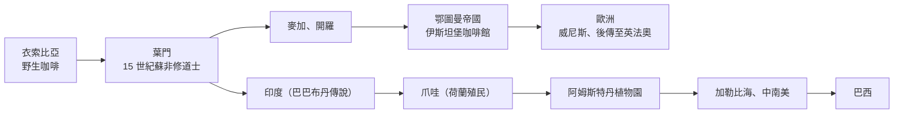

<callout icon="🎯" color="brown_bg">
<b>學習目標</b>

- 說得出咖啡從衣索比亞到全世界的傳播路線
- 認識各國獨特的咖啡文化、喝法與背後的歷史
- 理解「三波咖啡浪潮」與現代咖啡產業的形成
</callout>

## 1. 傳播路線總覽

你今天在巷口喝到的咖啡，背後是一條走了五百多年的路。這一節先用一張圖把整條路線攤開，後面各節再沿著這條路一站一站往下走。

圖上有兩條線：上面是「喝咖啡的習慣」從葉門傳進伊斯蘭世界與歐洲，塑造了咖啡館文化；下面是「咖啡樹」被帶到亞洲殖民地再落腳中南美洲，決定了今天的產地版圖。

## 2. 起源：衣索比亞與葉門

咖啡是誰「發現」的？這一節分開流傳最廣的故事與史料能證明的事。

### 牧羊人卡河的傳說

最著名的故事是衣索比亞牧羊人<b>卡河（Kaldi）</b>：他發現羊群吃了某種紅色果實後興奮跳躍，便把果實帶到修道院，修士發現它能讓人整夜清醒。

這個故事寫成文字的時間要晚到十七世紀，歷史學家認為是傳說而非史實。不過它仍是咖啡文化裡最常被講述的起源故事。

### 葉門的蘇非修道士

史料能確認的最早記錄，是<b>十五世紀葉門的蘇非派修道士</b>喝咖啡。蘇非派是伊斯蘭教中重視冥想與靈修的一支，修道士需要在夜間祈禱與冥想時保持清醒，咖啡正好派上用場。

「咖啡」這個詞也從這裡來。阿拉伯文「qahwa」原本可能指酒類飲料，後來轉指咖啡，再經土耳其文 kahve、義大利文 caffè，演變成歐洲各語言的咖啡一詞。

葉門的<b>摩卡港</b>後來成為咖啡輸出中心，長期壟斷世界咖啡貿易。今天的「摩卡」一詞就是這段歷史的痕跡。

### 衣索比亞咖啡儀式（Buna）

在衣索比亞，咖啡儀式至今仍是家庭與社交生活的核心。流程大致如下：

1. 當場用平底鍋烘焙生豆，並讓客人聞烘焙的煙
2. 用臼杵研磨
3. 用陶壺 <b>Jebena</b> 煮咖啡
4. 常搭配點燃乳香、分享爆米花或烤穀物

傳統上要喝<b>三輪</b>：第一輪 Abol、第二輪 Tona、第三輪 Baraka（有「祝福」之意）。整個過程可長達一兩小時，重點不在咖啡本身，而是陪伴與交流。

## 3. 伊斯蘭世界與鄂圖曼帝國

咖啡離開葉門之後，第一個大舞台是伊斯蘭世界的城市。這裡誕生了最早的咖啡館，也出現了第一批「禁咖啡令」，兩件事其實互為因果。

### 咖啡館的誕生與禁令

咖啡隨朝聖者與商人傳到麥加、開羅。<b>1511 年麥加</b>曾因咖啡館聚眾議論而一度禁止咖啡，但不久就被廢止。

<b>十六世紀中葉</b>，伊斯坦堡出現咖啡館，成為下棋、聽詩、談論政治的場所，被稱為「智者的學校」。正因為咖啡館讓人聚在一起說話，蘇丹穆拉德四世等統治者曾嚴厲禁止咖啡館，原因多半是擔心民眾聚集議論政治。這個模式後來在歐洲一再出現。

### 土耳其咖啡

<b>土耳其咖啡</b>的做法是把極細的咖啡粉與水（以及糖）放入長柄小銅壺 <b>Cezve</b>，慢慢加熱到起泡但不沸騰，連渣倒入小杯，靜置讓渣沉澱再喝。

因為糖是一開始就一起煮的，點單時要先說糖量：無糖（sade）、少糖、中糖、多糖。喝完後還可以把杯子倒扣，用杯底殘渣的形狀<b>占卜</b>，這是流傳至今的娛樂。

土耳其咖啡文化與傳統在 2013 年列入聯合國教科文組織（UNESCO）的人類非物質文化遺產代表名錄。

### 阿拉伯咖啡

<b>阿拉伯咖啡（Qahwa）</b>則是另一種風景：淺焙咖啡加入大量豆蔻，有時加番紅花或丁香，用長嘴壺 <b>Dallah</b> 倒入無把小杯，搭配椰棗。它是歡迎與款待的象徵，在 2015 年以「阿拉伯咖啡，慷慨的象徵」之名列入非物質文化遺產，由阿聯、沙烏地阿拉伯、阿曼與卡達共同提報。

## 4. 歐洲

咖啡進入歐洲後，各國把它變成不同的東西：英國人在咖啡館做生意，法國人談思想，維也納人把咖啡館當客廳，義大利人站著一口喝完。

### 威尼斯與教會

威尼斯商人在十七世紀把咖啡帶入歐洲。流傳一個著名故事：教廷有人認為咖啡是「異教徒的飲料」，教宗克萊蒙八世品嚐後認為它太美味，不該只讓異教徒享有。這個「為咖啡洗禮」的故事多半是傳說。

1720 年開業的威尼斯<b>佛羅里安咖啡館（Caffè Florian）</b>至今仍在營業，是世界最古老的咖啡館之一。

### 英國：便士大學

英國第一家咖啡館約在 1650 年前後於牛津開業，一般認為是一位名叫 Jacob 的人在 Angel 客棧開設。之後咖啡館很快在倫敦遍地開花。

當時的咖啡館被稱為<b>「便士大學」（Penny Universities）</b>：付一便士就能進場喝咖啡、讀報、與學者商人討論。

最有名的例子是<b>勞埃德咖啡館（Lloyd's Coffee House）</b>。它在 1680 年代開業（最早的文字記錄是 1688 年的《倫敦公報》），船東與船長在此交換航運消息，保險人也來這裡承接海上保險，後來發展成著名的勞埃德保險市場。倫敦證券交易所也與咖啡館的交易活動有淵源。

查理二世曾在 1675 年下令關閉咖啡館，理由是那裡散布不實與惡意的言論，但因反彈太大而很快撤回。後來英國民眾的飲品逐漸轉向茶，這與東印度公司的貿易利益有關。

### 法國：啟蒙運動的咖啡館

1686 年開業的巴黎<b>普羅科普咖啡館（Le Procope）</b>，伏爾泰等啟蒙思想家曾是常客。咖啡館文化與法國大革命前的討論風氣息息相關。

法國人日常的喝法很簡單：早餐是 <b>Café au lait</b>，用大碗裝的咖啡牛奶，常拿麵包沾著吃；餐後則是一小杯濃縮。

### 維也納：咖啡館是客廳

1683 年鄂圖曼軍團圍攻維也納失敗撤退，留下大量咖啡豆。傳說一位名叫 <b>Kolschitzky</b> 的人因戰功獲得這些豆子，開了城裡第一家咖啡館「藍瓶子」，並加入牛奶與糖讓市民接受。

歷史學家認為這段故事有許多渲染。維也納觀光局的資料指出，有文獻可考的第一家維也納咖啡館開於 1685 年。不過 Kolschitzky 的故事確實塑造了維也納咖啡的起源形象。

<b>維也納咖啡館文化</b>的特色是：點一杯咖啡就能坐一整天讀報、寫作、下棋，咖啡會附上一杯水，服務生穿著正式。奧地利在 2011 年將它列入國家級非物質文化遺產名錄。

常見品項有：
- <b>Melange</b>：類似卡布奇諾
- <b>Einspänner</b>
- <b>Verlängerter</b>：加水的濃咖啡

### 德國

巴哈約在 1730 年代寫下《<b>咖啡清唱劇</b>》，幽默描寫一位女兒為了咖啡與父親討價還價，反映當時萊比錫咖啡館的流行。

德國人也有 <b>Kaffeeklatsch</b>，就是咖啡配蛋糕的下午茶會文化。

普魯士的腓特烈大帝在 1777 年前後限制咖啡，以保護從小喝啤酒的民風與國庫外匯；1781 年起更由國家壟斷咖啡烘焙，還雇用退伍傷兵當「咖啡嗅探員」，循著烘豆香味查緝私烘。

德國對沖煮器材的貢獻也很大：1908 年 Melitta 發明了紙濾（見第 05 篇）。

### 義大利：吧檯文化

在義大利，咖啡館（bar）是日常生活的一部分。多數人<b>站在吧檯（al banco）</b>快速喝完一杯濃縮，坐著喝常常較貴，因為多了桌邊服務的費用。

常見習慣是：卡布奇諾多在早上搭配可頌喝，午餐後較少點加大量牛奶的飲品，餐後喝一杯濃縮。

拿坡里還有<b>待用咖啡（Caffè Sospeso）</b>的傳統：多付一杯咖啡的錢，留給下一位需要的陌生人。

## 5. 殖民擴張與咖啡的陰暗面

歐洲人愛上咖啡後，就想自己種。這一節講咖啡樹如何被帶到各地，以及這段擴張的代價。

### 打破葉門的壟斷

十七世紀末，荷蘭人在<b>爪哇</b>建立大規模咖啡種植地，打破了葉門的壟斷。

荷蘭送給法王路易十四的咖啡樹，它的後代在 1720 年代由法國海軍軍官 <b>Gabriel de Clieu</b> 帶到加勒比海的馬提尼克。傳說航程中淡水不足，他把自己的飲用水分給幼苗。

<b>巴西</b>咖啡的起點也有個浪漫傳說：1727 年葡萄牙軍官 <b>Francisco de Melo Palheta</b> 被派往法屬圭亞那調解邊界等爭端，總督夫人送他一束花，裡面藏著咖啡種子。

### 浪漫故事背後

這些故事聽起來很浪漫，但咖啡產業的擴張與<b>奴隸制度、殖民剝削</b>緊密相連。加勒比海（特別是法屬聖多明哥，今海地）與巴西的莊園，大量依賴被奴役的非洲人。

理解這段歷史，有助於理解今天關於公平貿易與小農收入的討論。

## 6. 美國與三波咖啡浪潮

「第三波咖啡」其實是從美國咖啡史切出來的分期。先看咖啡怎麼在美國生根。

1773 年<b>波士頓茶黨事件</b>後，喝咖啡在殖民地人民中帶有愛國意味，咖啡逐漸取代茶，成為美國人的主要飲品。南北戰爭與兩次世界大戰中，咖啡也是士兵的重要補給。

### 第一波：普及

二十世紀上半葉，罐裝咖啡粉與<b>即溶咖啡</b>讓咖啡進入每個家庭。這一波的特色是方便、便宜、標準化，品質不是重點。

### 第二波：咖啡館與義式飲品

1966 年，荷蘭裔的 <b>Alfred Peet</b> 在加州柏克萊開設 Peet's Coffee，以新鮮深焙豆改變了美國人的咖啡觀念。

1971 年在西雅圖創立的星巴克，創辦人曾向 Peet 學習。之後<b>霍華‧舒茲</b>在 1983 年造訪米蘭，被義大利咖啡吧文化觸動，把「第三空間」（家與辦公室之外的第三個去處）與義式加奶飲品推向全球。

這一波的特色是品牌、體驗、義式飲品，烘焙偏深。

### 第三波：精品咖啡

「第三波」這個說法在 2000 年代初期由咖啡專業人士提出並流行起來，一般認為出自烘豆師 Trish Rothgeb（當時名為 Trish Skeie）在 2002 至 2003 年間為烘豆師公會刊物寫的文章。

第三波把咖啡視為像葡萄酒一樣的農產品，強調<b>產地、品種、處理、可追溯、淺焙、手沖、直接貿易</b>。「直接貿易」指烘豆商跳過層層中間商，直接向農民採購並談價。

代表品牌如 Intelligentsia、Stumptown、Counter Culture、Blue Bottle，以及北歐的淺焙風格（第 9 節會詳談）。

### 第四波？

有人把近年的科學化沖煮、發酵處理、產地端的品牌化、永續與產業公平稱為第四波，但定義尚無共識。

## 7. 亞洲

亞洲各地也長出了自己的咖啡文化，有不少反過來影響了世界。

### 日本

江戶時代，荷蘭人在長崎出島帶來咖啡，但一開始並不流行。

<b>1888 年</b>，鄭永慶在東京下谷西黑門町（今上野一帶）開設「可否茶館」，被視為日本第一家正式咖啡館。店裡除了咖啡，還有撞球、紙牌與報刊，不過只經營了約四年就收掉。

昭和時期發展出<b>喫茶店（Kissaten）</b>文化：昏暗燈光、木質吧檯、老闆一杯一杯手沖或用賽風煮，菜單上有厚片吐司與拿坡里義大利麵。

<b>1969 年</b>，上島珈琲（UCC）推出罐裝牛奶咖啡，UCC 稱之為世界第一款罐裝咖啡，開啟了罐裝與販賣機咖啡文化。

日本對手沖器材、賽風、冰滴、烘焙的講究，深深影響了世界精品咖啡，許多第三波品牌都從日本喫茶店得到靈感。

### 越南

十九世紀，法國傳教士與殖民者把咖啡引入越南。

越南人用<b>越南滴漏壺（Phin）</b>煮咖啡：這是放在杯上的金屬滴漏器，咖啡慢慢滴出，味道濃郁，再搭配<b>煉乳</b>。用煉乳是因為熱帶氣候下鮮奶難以保存。冰的版本就是 <b>Cà phê sữa đá</b>。

<b>蛋咖啡（Cà phê trứng）</b>的來歷，依其創始家族的說法是：1946 年，在河內一家飯店工作的調酒師<b>阮文江（Nguyễn Văn Giảng）</b>，因戰時牛奶短缺，用蛋黃加糖打成綿密的泡沫代替牛奶。他後來開了自己的咖啡館，蛋咖啡也成為河內名物。

越南的咖啡產業從十九世紀末起持續發展，1980 年代改革開放後羅布斯塔產量快速成長，越南約在 2000 年前後躍升為世界第二大產國。依美國農業部 2025/26 年度的預估，越南產量約 3,080 萬袋（每袋 60 公斤），其中約九成五是羅布斯塔（數字依最新公告為準）。

近年的人氣喝法還有<b>椰子咖啡（Cà phê cốt dừa）</b>。

### 香港、馬來西亞、新加坡

香港的<b>鴛鴦</b>是咖啡與奶茶混合，茶餐廳的代表飲品。

馬來西亞與新加坡的 <b>Kopi</b>，豆子常以人造奶油與糖一起深焙，用布袋沖泡。點單有一套術語，像點珍奶時說「微糖去冰」一樣：

- Kopi：加煉乳
- Kopi-O：加糖黑咖啡
- Kopi-C：加淡奶與糖
- Kopi-O Kosong：無糖黑咖啡

### 印度南部

<b>南印濾滴咖啡（Filter Kaapi）</b>的咖啡常混入菊苣，用雙層金屬濾器慢慢滴出，再加大量熱牛奶與糖，在兩個金屬容器之間高高地來回倒，倒出泡沫。

### 韓國

韓國是咖啡館密度極高的國家之一，咖啡館注重空間設計與甜點。

<b>Dalgona 咖啡</b>是把即溶咖啡、糖、熱水以等比例打發成泡沫，鋪在冰牛奶上，2020 年疫情居家時期在社群網路爆紅。

### 台灣

台灣最早的咖啡種植記錄，常見說法是 1884 年英商德記洋行在北部（一般認為在三峽一帶）試種。到了日治時期，日本人有計畫地引進與栽培咖啡，雲林古坑（荷苞山）等地成為早期產區。

戰後，西門町一帶有歷史悠久的老咖啡館，是文人與音樂人的聚會場所。2000 年代起，便利商店現煮咖啡讓咖啡成為全民日常，例如 7-ELEVEN 在 2004 年推出 CITY CAFE。

之後獨立咖啡館與精品烘豆廠蓬勃發展，台灣咖啡師在國際賽事中表現亮眼，例如<b>吳則霖（Berg Wu）在 2016 年於都柏林奪得世界咖啡大師比賽（WBC）冠軍</b>，是台灣第一位 WBC 冠軍。高海拔小農咖啡與在地評鑑活動，也持續推動本地品質。

## 8. 美洲與其他地區

世界上還有許多地方用自己的方式喝咖啡，很多做法你在台灣的咖啡館也點得到。

| 地區 | 喝法 | 故事與細節 |
| --- | --- | --- |
| 古巴 | <b>Cafecito</b>：深焙濃咖啡加糖 | 先用最早滴出的少量咖啡與糖快速攪拌成淺色糖泡（espuma），再倒入其餘咖啡，表面會有一層糖泡 |
| 墨西哥 | <b>Café de olla</b> | 在陶鍋中加入肉桂與粗黑糖 piloncillo 煮咖啡，陶鍋被認為能增添風味 |
| 希臘 | <b>Frappé</b>、<b>Freddo Espresso</b> | 常見說法是 1957 年塞薩洛尼基博覽會上，雀巢的工作人員 Dimitris Vakondios 找不到熱水，就把即溶咖啡、冷水與糖放進搖搖杯搖勻，誕生了希臘國民飲品冰搖咖啡 |
| 瑞典 | <b>Fika</b> | 咖啡搭配肉桂捲等甜點的暫停時光，是生活文化也是職場文化；北歐國家人均咖啡消費量長期位居世界前列，淺焙風格也影響了全球 |
| 西班牙 | <b>Cortado</b>、<b>Café con leche</b>、<b>Carajillo</b> | Carajillo 是濃縮加烈酒（白蘭地、蘭姆等），有說法認為與士兵喝咖啡壯膽有關；西班牙瓦倫西亞的 <b>Café bombón</b> 是濃縮加煉乳分層 |
| 葡萄牙 | <b>Bica</b>、<b>Galão</b> | 里斯本的 Bica 是濃縮的別名；Galão 是用高玻璃杯裝的大量牛奶咖啡 |
| 愛爾蘭 | <b>Irish Coffee</b> | 一般認為是 1940 年代（常見說法為 1943 年）愛爾蘭福因斯（Foynes）水上飛機機場的廚師 Joe Sheridan 為寒冷的過境旅客調製，1952 年由旅遊作家 Stanton Delaplane 帶回舊金山 Buena Vista 酒吧而風靡美國（配方見第 08 篇） |
| 塞內加爾 | <b>Café Touba</b> | 咖啡豆與稱為 selim 的香料一起烘焙，帶有胡椒般辛香，與當地宗教教派有關 |
| 阿爾及利亞、葡萄牙 | <b>Mazagran</b> | 加冰或冷水的咖啡加檸檬，常被認為是最早的冰咖啡之一，與十九世紀法軍在阿爾及利亞的故事有關，也是現代「西西里咖啡」的遠親 |

## 9. 北歐咖啡浪潮

第三波咖啡常被講成美國的故事，但影響今天精品咖啡「味道」最深的，很可能是挪威、丹麥、瑞典等北歐國家。你喝過的淺焙、果酸明亮、包裝寫滿農場資訊的咖啡，很大一部分從這裡出發。

### 背景：喝最多咖啡的地方

北歐國家的人均咖啡消費量長期位居世界前列，咖啡是家庭與職場的日常，瑞典的 Fika 就是一例。

傳統喝法以<b>濾泡咖啡</b>與挪威的<b>煮咖啡（kokekaffe）</b>為主，而不是義式濃縮。大量喝不加奶的黑咖啡，讓豆子本身的品質無所遮蔽，好壞一喝就知道。

加上北歐的超市品牌本來就有偏淺焙的傳統，消費者對「明亮」的咖啡並不陌生。

### 世界咖啡大師比賽的北歐時代

世界咖啡大師比賽（WBC）是咖啡師的國際賽事。

<b>2000 年</b>，首屆 WBC 在蒙地卡羅舉行，挪威的 <b>Robert Thoresen</b> 奪冠。有介紹說他入行前是建築師，這點未查得一手來源。他在 1990 年代後期於奧斯陸經營濃縮吧 Java 與 Mocca，之後在 2005 年創立烘豆廠 Kaffa。

接著北歐選手幾乎包辦早期冠軍：丹麥的 Martin Hildebrandt（2001）、Fritz Storm（2002），挪威的 <b>Tim Wendelboe</b>（2004），丹麥的 <b>Klaus Thomsen</b>（2006）。

這些冠軍之後投入烘豆與生豆採購，把「比賽等級的品質」帶進日常的咖啡館。

### 代表人物與品牌

| 名字 | 地點 | 重要性 |
| --- | --- | --- |
| <b>Tim Wendelboe</b> | 挪威奧斯陸 | 2004 年 WBC 冠軍、2005 年世界杯測冠軍，2007 年開設同名微型烘豆廠與咖啡吧。他曾說，是喝到出口商帶來的樣品後意識到自己的烘焙太深，才改走淺焙。他更進一步在 2015 年於哥倫比亞買下自己的農場，從種植端掌握品質；也與 Morten Wennersgaard 等人在 2011 年前後創立生豆進口商 Nordic Approach（各來源對創辦成員說法不一） |
| <b>Coffee Collective</b> | 丹麥哥本哈根 | 由 Klaus Thomsen 等人在 2007 年創立為烘豆廠，第一家咖啡館 2008 年在 Jægersborggade 開幕，以直接貿易與公開採購價格聞名 |
| <b>Koppi</b> | 瑞典赫爾辛堡 | 2007 年成立，常被視為濃縮通寧（Espresso Tonic）的發源地；較可靠的記錄是 2007 年先在奧斯陸由 Koppi 創辦人身邊的咖啡師調出，同年 Koppi 開店時放上菜單推廣（見第 08 篇） |
| <b>Kaffa、Solberg & Hansen、Fuglen</b> | 挪威 | Kaffa 由 Thoresen 創立；Solberg & Hansen 常被稱為挪威最大的精品烘豆商，很早就積極參與 Cup of Excellence 競標；Fuglen 後來把奧斯陸風格帶到東京 |

### 北歐風格的特徵

1. <b>極淺的烘焙</b>：一爆後短時間內下豆，保留果酸與花香，幾乎沒有烘焙苦味。「一爆」是豆子受熱時第一次發出劈啪聲的階段，代表豆子開始熟成
2. <b>以濾泡為主</b>：淺焙在手沖與滴濾中最能展現透明感；做成濃縮則對技術要求極高
3. <b>透明與直接貿易</b>：公開農場、品種、採購價格，與生產者建立長期關係
4. <b>季節性</b>：只賣當季新鮮生豆，像買當季水果一樣
5. <b>淺焙也是照妖鏡</b>：生豆的瑕疵與老化無處躲藏，這倒逼烘豆商去買更好的生豆

### 爭議與影響

北歐風格並非人人買單。批評者認為部分北歐式烘焙<b>發展不足</b>，也就是豆子內部還沒烤透，喝起來像酸果汁，帶穀物與青草味。支持者則認為好的淺焙只是「快」而不是「生」，關鍵在烘焙曲線的控制（見第 03 篇）。

今天大多數精品烘豆商採用介於北歐極淺與傳統中焙之間的風格，但「先尊重豆子本身」的想法，已經成為精品咖啡的共識。

回頭看整個第三波，北歐浪潮與日本喫茶店文化是它的兩個重要源頭：前者追求「亮、透」，後者追求「濃、圓」（見第 05 篇第 7 節）。美國的第三波品牌大量吸收了兩者。

## 參考資料

- [Turkish coffee culture and tradition（UNESCO）](https://ich.unesco.org/en/RL/turkish-coffee-culture-and-tradition-00645)：土耳其咖啡文化與傳統於 2013 年列入人類非物質文化遺產代表名錄
- [Decision of the Intergovernmental Committee: 10.COM 10.B.32（UNESCO）](https://ich.unesco.org/en/decisions/10.COM/10.B.32)：阿拉伯咖啡於 2015 年列入代表名錄，由阿聯、沙烏地、阿曼、卡達提報
- [Coffee and commerce（Lloyd's）](https://www.lloyds.com/about-lloyds/history/coffee-and-commerce)：勞埃德咖啡館 1688 年首見於《倫敦公報》
- [English coffeehouses in the 17th and 18th centuries（Wikipedia）](https://en.wikipedia.org/wiki/English_coffeehouses_in_the_17th_and_18th_centuries)：牛津 1650 年咖啡館、查理二世 1675 年禁令
- [Coffee sniffers（Wikipedia）](https://en.wikipedia.org/wiki/Coffee_sniffers)：普魯士限制咖啡與 1781 年烘焙壟斷
- [Calling the Shots: 20 Years of the World Barista Championship（SCA）](https://sca.coffee/sca-news/25-magazine/issue-9/english/calling-the-shots-20-years-of-the-world-barista-championship-25-magazine-issue-9)：首屆 WBC 2000 年於蒙地卡羅舉行，Robert Thoresen 奪冠
- [Berg Wu of Taiwan wins 2016 World Barista Championship（BeanScene）](https://www.beanscenemag.com.au/berg-wu-of-taiwan-wins-2016-world-barista-championship)：吳則霖 2016 年於都柏林奪得 WBC 冠軍
- [Klaus Thomsen, Copenhagen's coffee pioneer（Wonderful Copenhagen）](https://www.wonderfulcopenhagen.com/wonderful-copenhagen/international-press/press-kit-gastronomy/klaus-thomsen-copenhagens-coffee-pioneer)：Coffee Collective 2007 年創立為烘豆廠、2008 年於 Jægersborggade 開設咖啡館
- [Espresso and tonic（Wikipedia）](https://en.wikipedia.org/wiki/Espresso_and_tonic)：濃縮通寧最早記錄為 2007 年奧斯陸，與 Koppi 創辦人有關
- [Egg coffee（Wikipedia）](https://en.wikipedia.org/wiki/Egg_coffee)：蛋咖啡由阮文江於 1946 年在河內 Metropole 飯店任職時發明的家族說法
- [Vietnam cements status as world's No.2 coffee producer（VOV）](https://english.vov.vn/en/economy/vietnam-cements-status-as-worlds-no2-coffee-producer-robusta-powerhouse-post1291673.vov)：越南為世界第二大產國，USDA 2025/26 預估約 3,080 萬袋、羅布斯塔約占九成五

## 自我檢核

<callout icon="💬" color="gray_bg">
先自己回答，再展開參考答案。
</callout>

<toggle>
Q1 咖啡作為飲品最早可考的記錄在哪裡？與卡河傳說有什麼不同？

最早可考的記錄是十五世紀葉門的蘇非派修道士，他們用咖啡在夜間祈禱時保持清醒。卡河的牧羊故事寫成文字要晚到十七世紀，被視為傳說，而不是史實。
</toggle>

<toggle>
Q2 請描述衣索比亞咖啡儀式的流程與意義。

當場用平底鍋烘焙生豆、讓客人聞烘焙的煙、用臼杵研磨、用陶壺 Jebena 煮咖啡，常搭配乳香與爆米花，傳統上喝三輪（Abol、Tona、Baraka）。意義在於陪伴、待客與社群交流，而不只是喝飲品。
</toggle>

<toggle>
Q3 為什麼英國的咖啡館被稱為「便士大學」？有哪些影響深遠的例子？

付一便士就能進場喝咖啡、讀報，與學者、商人交流討論，達到如大學般的學習效果。例如勞埃德咖啡館是船東與保險人交換航運資訊的場所，後來發展成勞埃德保險市場；倫敦的證券交易也與咖啡館有淵源。
</toggle>

<toggle>
Q4 越南為什麼喝咖啡要加煉乳？蛋咖啡又是怎麼來的？

熱帶氣候加上過去缺乏冷藏，鮮奶難以保存，煉乳耐放又能中和羅布斯塔的苦。依創始家族的說法，蛋咖啡是 1946 年河內一位在飯店工作的調酒師阮文江因牛奶短缺，用蛋黃加糖打成綿密泡沫代替牛奶而誕生，後來成為河內的名物。
</toggle>

<toggle>
Q5 請說明第一、二、三波咖啡浪潮的差別。

第一波是咖啡的普及，靠罐裝咖啡粉與即溶咖啡，重方便與價格；第二波以 Peet's、星巴克為代表，強調品牌、咖啡館體驗與義式加奶飲品，偏深焙；第三波把咖啡視為像葡萄酒的農產品，強調產地、品種、處理、可追溯、淺焙、手沖與直接貿易。
</toggle>

<toggle>
Q6 土耳其咖啡要怎麼煮、怎麼點？

用極細的咖啡粉與水（與糖）一起放入長柄小銅壺 Cezve，慢火加熱到起泡但不沸騰，連渣倒入小杯，靜置讓渣沉澱再喝。因為糖是一起煮的，點單時要先說糖量：無糖、少糖、中糖或多糖。喝完還可以倒扣杯子用殘渣占卜。
</toggle>

<toggle>
Q7 在義大利喝咖啡有哪些需要知道的文化習慣？

多數人站在吧檯快速喝完濃縮，坐著喝常常較貴；卡布奇諾多在早上喝，餐後通常喝濃縮；點「latte」會得到一杯牛奶，要說 caffè latte；拿坡里有「待用咖啡」的善意傳統。
</toggle>

<toggle>
Q8 咖啡在歐洲擴散時，為什麼常被統治者禁止？

咖啡館讓民眾聚集、交流資訊與討論政治，統治者擔心它成為反對聲音的溫床（例如麥加 1511 年、鄂圖曼蘇丹、英國查理二世 1675 年）；也有經濟與宗教理由，例如普魯士為保護外匯與啤酒產業而限制咖啡。這些禁令多半不久就因反彈而失效。
</toggle>

<toggle>
Q9 希臘冰搖咖啡是怎麼誕生的？

常見的說法是 1957 年塞薩洛尼基博覽會上，一位雀巢工作人員想喝咖啡但找不到熱水，就把即溶咖啡、冷水與糖放進搖搖杯搖勻，得到綿密的泡沫冰咖啡，後來成為希臘國民飲品。
</toggle>

<toggle>
Q10 請用三件事說明日本對世界咖啡文化的影響。

一是喫茶店文化對手沖、賽風、法蘭絨與冰滴的職人精神，啟發了許多第三波品牌；二是 V60、Kalita、Kono、Origami 等日本器材成為世界精品咖啡的標準工具；三是 1969 年起的罐裝咖啡與販賣機文化。此外，日本咖啡師如粕谷哲在世界賽事中的成就，也影響了全球的手沖技術。
</toggle>

<toggle>
Q11 北歐咖啡浪潮有哪些特徵？為什麼會在北歐出現？

特徵是極淺的烘焙、以濾泡為主、重視產地透明與直接貿易、強調季節性。背景是北歐人均咖啡消費量高、傳統上大量喝黑咖啡與濾泡咖啡，消費者本來就熟悉偏淺的烘焙；加上 2000 年代初期北歐咖啡師在世界咖啡大師比賽中屢屢奪冠，這些冠軍後來投入烘豆與生豆採購，把比賽等級的品質帶進日常。
</toggle>

<toggle>
Q12 請說出兩位北歐世界咖啡大師冠軍，以及他們後來對產業的貢獻。

挪威的 Robert Thoresen 是 2000 年首屆 WBC 冠軍，後來在 2005 年創立烘豆廠 Kaffa；挪威的 Tim Wendelboe 是 2004 年 WBC 冠軍，開設同名烘豆廠，推廣淺焙並在哥倫比亞經營自己的農場。也可以答丹麥的 Klaus Thomsen（2006 年冠軍），他共同創立 Coffee Collective，以直接貿易與價格透明聞名。
</toggle>

<toggle>
Q13 有人批評北歐式淺焙「喝起來像沒烤熟」，你怎麼看？

這個批評指向的是發展不足的烘焙：青草、穀物、尖銳酸澀。但淺焙不等於發展不足；好的淺焙在短時間內讓豆子內外充分發展，喝起來是明亮的果酸與甜感，而不是生豆味。差別在烘焙曲線的控制與生豆品質，最終要以杯測與個人喜好判斷。
</toggle>
