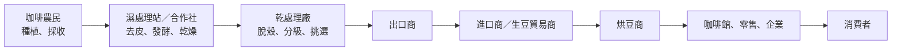

<callout icon="🎯" color="brown_bg">
<b>學習目標</b>

- 看懂一袋生豆從農場到烘豆廠的完整供應鏈，以及每個環節如何影響品質
- 理解生豆與熟豆的包裝、運輸與倉儲原則
- 認識咖啡的價格形成、貿易條件與商業杯測流程
- 掌握台灣咖啡進口與食品衛生法規的重點，知道烘焙師與咖啡師各自要注意什麼
</callout>

<callout icon="⚖️" color="gray_bg">
本篇的法規內容是學習用的重點整理，法規會修正，實際開業、進口或被稽查時，請以衛福部食品藥物管理署、地方衛生局與報關業者的最新說明為準。
</callout>

## 1. 供應鏈全貌

- 一支咖啡往往經過六、七手才到消費者手中。每多一手，資訊就可能少一點（品種、農場、處理細節），成本也多一層
- <b>直接貿易</b>縮短這條鏈：烘豆商直接與農場或處理站談價與品質，但仍需要出口商與進口商處理物流、通關與資金
- <b>農民的收入佔比</b>：在一杯幾十到上百元的咖啡中，農民拿到的通常只是很小的一部分，這是公平貿易、競標與價格透明運動關心的核心

## 2. 乾處理與出口準備

帶殼豆（羊皮紙豆）或日曬乾果在出口前，要在乾處理廠（dry mill）完成：

1. <b>脫殼（hulling）</b>：去除羊皮紙層或乾果皮
2. <b>拋光</b>（部分產區）：磨去殘留銀皮，讓外觀更乾淨
3. <b>尺寸分級</b>：篩網分出不同大小（第 01 篇）
4. <b>密度分級</b>：用重力台（gravity table）振動分出輕豆，輕豆常是未熟或蟲蛀豆
5. <b>光學色選</b>：機器以相機剔除顏色異常的豆子（黑豆、發酵豆）
6. <b>人工挑豆</b>：精品微批次常再以人工複檢
7. <b>秤重裝袋、取樣</b>：留下裝運前樣品給買家杯測

### 常見的標準袋重

| 產地 | 常見袋重 |
| --- | --- |
| 巴西、衣索比亞、肯亞、多數非洲與亞洲產區 | 60 公斤（國際統計的「一袋」也以 60 公斤計） |
| 哥倫比亞 | 70 公斤 |
| 中美洲多國 | 69 公斤 |
| 精品微批次 | 常見 30 公斤或更小的箱裝、真空包裝 |

一個 20 呎貨櫃大約可裝三百袋上下、十幾到二十公噸的生豆，這是大宗貿易的基本單位。小型烘豆商通常向進口商「拆袋」購買，而不是自己進整櫃。

## 3. 生豆的包裝、運輸與倉儲

### 包裝

| 方式 | 說明 | 優缺點 |
| --- | --- | --- |
| <b>麻袋（Jute）</b> | 傳統的黃麻袋 | 便宜、透氣，但會與外界交換水氣與氣味，生豆老化快，也可能沾染麻袋味 |
| <b>麻袋＋高阻隔內袋</b> | 麻袋內套一層多層塑膠阻隔袋（業界常以品牌 GrainPro 代稱） | 穩定含水率與氣味，延緩老化，是精品生豆的常態 |
| <b>真空包裝箱裝</b> | 抽真空後裝箱 | 保存效果最好，常用於競標豆與高價微批次，成本最高 |
| <b>散裝貨櫃（bulk liner）</b> | 貨櫃內鋪大型內襯，直接倒入生豆 | 用於大宗商業豆，節省包材與搬運 |

### 海運風險

- <b>貨櫃雨（container rain）</b>：生豆本身含水，貨櫃穿越不同氣候區、日夜溫差大時，水氣會在櫃頂凝結滴下，讓上層生豆受潮發霉。常見對策是在櫃壁與櫃頂鋪吸濕紙板、放乾燥劑，並選擇不曝曬的堆放位置
- <b>發霉與赭麴毒素</b>：受潮的生豆可能長出產生赭麴毒素（Ochratoxin A）的黴菌，這是食安關注的重點（第 7 節）
- <b>高溫</b>：港口曝曬與熱帶航線會加速老化，精品生豆有時會用冷藏貨櫃或溫控倉儲
- 海運時間依航線從數週到一個多月不等，加上通關與內陸運輸，這就是「新產季」上市比採收晚好幾個月的原因

### 倉儲原則

- <b>三個關鍵字：陰涼、乾燥、穩定</b>。常見的實務目標是溫度低於約 25°C、相對濕度約 60% 以下，並避免劇烈波動
- <b>離地離牆</b>：用棧板堆放，留通風與檢查空間，防蟲防鼠
- <b>遠離異味</b>：生豆會吸附氣味，不要與香料、清潔劑、燃料放在一起
- <b>先進先出（FIFO）</b>並定期杯測追蹤：生豆老化的徵兆是酸質變平、出現紙板、麻袋、木頭味（past crop），生豆顏色也會從藍綠轉為黃褐

## 4. 熟豆的包裝

| 元素 | 作用 |
| --- | --- |
| <b>單向排氣閥</b> | 讓熟豆釋放的 CO2 排出，且外部空氣不會進入；沒有它，封口後袋子會膨脹 |
| <b>多層阻隔袋（鋁箔或高阻隔塑料）</b> | 阻擋氧氣、光線與濕氣，延緩油脂氧化 |
| <b>充氮</b> | 封口前用氮氣置換袋內空氣，大廠與濾掛、膠囊常用 |
| <b>封口與夾鏈</b> | 開封後能重複密封，減少每次開封的接觸空氣 |

- 熟豆運送要避熱（夏天車內、日曬的物流站），高溫會讓風味快速流失
- 濾掛式咖啡在台灣很普及，因為是「先磨好」的產品，包裝阻隔與充氮的品質幾乎決定了風味

## 5. 咖啡的價格從哪裡來

### C 市場：咖啡的國際基準價

- 阿拉比卡的國際基準價是紐約洲際交易所（ICE）的阿拉比卡期貨，常稱 <b>C 市場（C market）</b>，以<b>美分／磅</b>報價；羅布斯塔則以倫敦市場的<b>美元／公噸</b>報價
- 實際生豆價格常寫成「<b>C 市場價格 ± 差價（differential）</b>」：品質好、產區受歡迎的豆子加價，品質差的減價
- 期貨價格受巴西天氣（霜害、乾旱）、全球庫存、匯率、貿易政策與投機資金影響，波動很大。2024 到 2025 年期間曾上漲到約每磅 4 美元的歷史高位，2026 年隨著巴西供應預期改善而回落；2026 年 10 月初約在每磅 2.9 美元上下。知道這個背景，就能理解咖啡館與烘豆商為什麼會跟著調價

### 精品咖啡的定價

- 精品微批次通常與 C 市場<b>脫鉤</b>，由品質（杯測分數）、稀有度與買賣雙方關係決定固定價格
- <b>競標</b>（Cup of Excellence、Best of Panama 等）讓頂級批次由市場出價
- 部分烘豆商公開「透明採購報告」，列出付給生產者的價格，是北歐與第三波的傳統（第 07 篇）

### 貿易條件（常見國際貿易術語）

| 條件 | 意思 | 風險何時轉給買方（簡化說法） |
| --- | --- | --- |
| <b>EXW（工廠交貨）</b> | 買方到賣方倉庫提貨，其餘自理 | 出倉就是買方的 |
| <b>FOB（船上交貨）</b> | 賣方負責把貨運到出口港並裝上船，生豆報價最常見的基準 | 裝上船後 |
| <b>CIF（含運費保險）</b> | 賣方付到目的港的運費與保險 | 裝上船後（但保險由賣方投保） |
| <b>DAP／DDP</b> | 送到指定地點；DDP 還含進口稅費 | 送達後 |

對小型烘豆商來說，最常見的是向台灣的生豆進口商買「在台現貨」，對方已經處理好運輸、通關與倉儲。

### 永續與法規趨勢

- <b>歐盟零毀林法規（EUDR）</b>：要求進入歐盟的咖啡等商品證明來自未在 2020 年底後毀林的土地，並可追溯到地塊。經兩次延後，目前預定 2026 年 12 月 30 日起對大型業者適用。它不只影響歐洲，也迫使產地建立 GPS 地塊與追溯資料，小農的合規成本是主要爭議

## 6. 商業杯測：用杯子做生意

### 樣品的生命週期

| 樣品 | 時間點 | 用途 |
| --- | --- | --- |
| <b>報價樣（Offer sample）</b> | 買賣前 | 買家杯測決定要不要買、談價 |
| <b>裝運前樣（Pre-shipment sample, PSS）</b> | 出口前，從準備裝櫃的批次取樣 | 確認要運的東西和報價樣一致；不符可以拒絕裝運 |
| <b>到貨樣（Arrival sample）</b> | 到港後 | 確認運輸中沒有受潮、沾染異味或老化 |
| <b>現貨樣（Spot sample）</b> | 已在進口商倉庫 | 烘豆商向進口商選豆時杯測 |

### 生豆的物理檢驗

杯測前通常先做物理檢驗：

- <b>含水率與水活性</b>（第 02 篇第 8 節）
- <b>瑕疵計數</b>：精品生豆標準是 350g 樣本中沒有一級瑕疵、全部瑕疵不超過 5 個。一級瑕疵例如全黑豆、全酸豆、乾果、黴豆、異物、嚴重蟲蛀；二級瑕疵例如部分黑豆、破碎豆、輕微蟲蛀、未熟豆（幾個二級瑕疵才算一個全瑕疵）
- <b>篩網分布</b>、<b>顏色與氣味</b>
- 不合格可以折價、要求更換或拒收，實際依合約而定

### 樣品烘焙

商業杯測用小型樣品烘豆機（sample roaster）烘成偏淺、發展充分的「杯測烘焙」，目的是公平呈現生豆本質，而不是做出最好喝的產品。烘壞的樣品會讓好豆被低估，所以樣品烘焙本身也是一門技術。

## 7. 台灣的咖啡進口

- 台灣大部分咖啡豆依賴進口（2021 年咖啡豆進口量約 4 萬公噸，國產大約只有一千公噸上下，見第 10 篇）
- 進口流程大致是：<b>報關 → 各主管機關簽審 → 食品邊境查驗 → 完稅放行</b>。財政部關務署負責關稅與通關，衛福部食品藥物管理署負責輸入食品查驗，地方衛生局負責市場端的稽查與抽驗；依貨品分類，可能還涉及動植物防疫檢疫
- <b>邊境查驗</b>依「食品及相關產品輸入查驗辦法」辦理（新版自 2026 年 1 月 1 日施行）。咖啡豆的抽驗重點包括<b>農藥殘留</b>與<b>赭麴毒素</b>，歷年不合格率很低，但查驗是抽樣而非逐批，烘豆商自己的到貨檢驗仍然重要
- <b>赭麴毒素</b>是部分黴菌產生的毒素，具腎毒性，屬 2B 類可能致癌物；在高溫多濕、保存不當時容易產生。乾燥良好的生豆（含水率約 12% 以下）與熟豆不易發霉，風險主要來自運輸與倉儲受潮
- <b>常見誤區</b>：自己出國帶回或網購進來分裝販賣。只要有販賣行為，不論數量多少都應依規定報驗，不能私下賣

## 8. 食品衛生安全：烘焙師與咖啡師的衛生法寶

### 法規架構

| 法規 | 重點 |
| --- | --- |
| <b>食品安全衛生管理法</b>（食安法） | 母法。第 8 條規定食品業者的從業人員、作業場所、設施衛生管理與品保制度，都要符合良好衛生規範準則；公告類別與規模的業者需登錄才能營業。第 22 條規範包裝食品標示，第 28 條禁止不實或誤導的標示與廣告 |
| <b>食品良好衛生規範準則</b>（GHP 準則） | 人員、設備器具、作業場所、食材與製程衛生的基本要求，是所有食品業者的底線 |
| <b>食品業者登錄</b>（「非登」系統） | 符合公告類別與規模的餐飲、製造、輸入、販賣業者都要登錄 |
| <b>食品安全管制系統準則</b>（HACCP） | 特定類別與規模的大型業者適用，小型咖啡館通常不在範圍內，但它的「危害分析、關鍵管制點」觀念值得學 |

- 罰則參考：違反 GHP 準則經限期改善仍未改善，可處新台幣 6 萬元以上的罰鍰；應登錄而未登錄，經限期改正仍未改正，也有罰則
- 衛生局稽查餐飲業時最常見的三大缺失：<b>從業人員體檢資料不完整、未辦理食品業者登錄、食材未分區或直接放在地上</b>。這三件事都不難，就是容易忽略

### 人員衛生（咖啡師與烘焙師共同）

- <b>健康檢查</b>：新進人員與在職人員每年至少一次，常見項目包括 A 型肝炎、手部皮膚病、出疹、膿瘡、外傷、傷寒等（項目可能隨準則修正調整），並保存報告備查。有上述狀況時不得從事接觸食品的工作
- <b>教育訓練</b>：接受食品衛生講習
- <b>服裝</b>：乾淨的工作服、帽子或髮網、必要時戴口罩；不留長指甲、不塗指甲油、作業時不戴飾品
- <b>手部清潔</b>：上工前、如廁後、碰觸垃圾或金錢後都要洗手；手上有傷口要包紮並戴手套

### 咖啡師的衛生重點

| 項目 | 做法 | 為什麼 |
| --- | --- | --- |
| <b>蒸氣管</b> | 每次打奶後立刻用專用濕布擦拭並短暫排氣 | 牛奶殘留在溫熱的噴嘴內外是細菌溫床；不排氣時牛奶可能被吸回管內 |
| <b>牛奶與植物奶</b> | 冷藏保存、開封標示日期與時間、先進先出、不把打過的牛奶反覆加熱使用 | 乳製品是咖啡館最容易變質的食材 |
| <b>過敏原</b> | 牛奶、豆漿、堅果奶用不同拉花鋼杯或確實清洗；清楚告知客人飲品成分 | 交叉污染可能讓過敏客人受傷 |
| <b>磨豆機與沖煮頭</b> | 每日反沖洗、清潔粉碗與分水網；磨豆機定期拆洗刀盤周圍 | 咖啡油脂會氧化酸敗，帶來油耗味與苦味 |
| <b>冰塊與製冰機</b> | 用冰鏟取冰、不用杯子直接舀；製冰機定期清洗消毒 | 冰塊是食品，而且是稽查抽驗不合格的常客 |
| <b>淨水系統</b> | 依廠商建議更換濾芯並留紀錄 | 同時關係衛生、風味與機器壽命（水垢） |
| <b>抹布分色</b> | 蒸氣管、吧台、杯具、地板用不同顏色抹布 | 避免交叉污染 |
| <b>食材儲存</b> | 離地存放、加蓋、生熟分開、標示效期 | 稽查最常見的缺失之一 |

- <b>咖啡因標示</b>：連鎖便利商店、連鎖速食與連鎖飲料業者販賣現場調製的咖啡，需依規定標示每杯咖啡因含量範圍（以顏色區分高、中、低），類別與細節以現行公告為準

### 烘焙師的衛生重點

| 項目 | 做法 |
| --- | --- |
| <b>生豆倉儲</b> | 離地離牆、防蟲防鼠、控制溫濕度、先進先出；定期檢查是否受潮發霉 |
| <b>烘焙前挑豆</b> | 移除石頭、金屬、黴豆等異物與瑕疵豆；大廠常備去石機與金屬偵測 |
| <b>烘豆機與煙道</b> | 定期清理銀皮收集桶、旋風集塵與煙道。銀皮與煙道油垢可燃，是烘豆廠火災的主要來源之一 |
| <b>排煙與異味</b> | 烘焙產生的煙與氣味可能引起鄰里投訴，規模較大時需要考慮排煙處理設備與地方環保規定 |
| <b>熟豆包裝標示</b> | 包裝食品依食安法第 22 條標示，常見項目包括品名、內容物名稱、淨重、食品業者名稱地址電話、原產地、有效日期等；品名要與本質相符，不能誤導 |
| <b>批號與追溯</b> | 記錄每批生豆來源、烘焙日、包裝批號與出貨對象，出問題時能召回 |

### 案例：標示不實的代價

2019 年台灣曾有知名咖啡品牌因咖啡豆標示不實而遭衛生機關稽查，案件移送檢察署。教訓是：<b>產地、品種、「100%」這類字眼都是法律承諾</b>，配方豆就要誠實寫配方，買不到新產季就要更新標籤。誠實標示同時保護消費者與品牌。

## 自我檢核

<callout icon="💬" color="gray_bg">
先自己回答，再展開參考答案。
</callout>

<toggle>
Q1 請說出一袋生豆從農場到咖啡館會經過哪些角色？直接貿易改變了什麼？

農民、濕處理站或合作社、乾處理廠、出口商、進口商（生豆貿易商）、烘豆商、咖啡館或零售。直接貿易讓烘豆商與生產者直接談品質與價格，資訊更透明、生產者通常分到更多，但物流、通關與資金仍常常需要出口商與進口商協助。
</toggle>

<toggle>
Q2 什麼是「貨櫃雨」？如何預防？

生豆含有水分，貨櫃在海運中經歷溫差時，水氣在櫃頂與櫃壁冷凝滴下，讓生豆受潮、發霉。預防方法包括使用高阻隔內袋、在櫃頂與櫃壁鋪吸濕紙板、放乾燥劑、避開曝曬的堆放位置，高價生豆可用溫控貨櫃。
</toggle>

<toggle>
Q3 為什麼精品生豆多用「麻袋＋高阻隔內袋」？

單用麻袋會讓生豆與外界交換水氣與氣味，含水率波動、吸附異味、老化加快。高阻隔內袋能穩定含水率與風味，延長生豆的最佳使用期；麻袋則提供外層保護與便於搬運。
</toggle>

<toggle>
Q4 「C 市場 + 30 美分」代表什麼意思？為什麼精品微批次常不用這種定價？

代表以紐約阿拉比卡期貨價格為基準，再加上每磅 30 美分的品質或產區差價。精品微批次的價值來自杯測品質與稀有度，和大宗商品的供需關係不大，所以常以固定價格或競標定價，也讓生產者不必承受期貨市場的劇烈波動。
</toggle>

<toggle>
Q5 報價樣、裝運前樣、到貨樣各自要確認什麼？

報價樣用來決定要不要買與談價；裝運前樣確認即將裝櫃的批次與報價樣一致，不符可以拒絕裝運；到貨樣確認運輸過程中沒有受潮、發霉、沾染異味或明顯老化。三者合起來保障買家拿到的就是當初喝到的咖啡。
</toggle>

<toggle>
Q6 你開了一間小咖啡館，衛生局來稽查，最常見的三大缺失是什麼？你會怎麼預先準備？

從業人員體檢資料不完整、未辦理食品業者登錄、食材未分區或直接放地上。準備方式：每位員工每年做健康檢查並把報告集中備查；開業前完成食品業者登錄；用層架與密封容器分區存放食材，全部離地、標示效期。
</toggle>

<toggle>
Q7 為什麼蒸氣管每次用完都要立刻擦拭並排氣？

牛奶殘留在溫熱的噴嘴上會迅速烤乾結塊、滋生細菌；停止打奶時管內可能形成負壓，把牛奶吸回管內。立刻擦拭與短暫排氣能清除外部殘留並把管內的牛奶吹出，同時保持下一杯奶泡的風味。
</toggle>

<toggle>
Q8 赭麴毒素是什麼？在咖啡供應鏈的哪個環節最需要控管？

是部分黴菌產生的毒素，具腎毒性，屬 2B 類可能致癌物。乾燥良好的生豆與熟豆不易發霉，風險主要來自產地乾燥不足、海運受潮與倉儲濕度過高，所以乾燥、包裝、運輸與倉儲是控管重點；台灣邊境查驗也將它列為咖啡豆抽驗項目。
</toggle>

<toggle>
Q9 烘豆廠為什麼要定期清理煙道與銀皮收集桶？

銀皮輕而易燃，煙道累積的油垢也可燃，遇到高溫或火星可能引發火災，是烘豆廠常見的火災原因。定期清理也能維持排風效率，讓烘焙曲線穩定。
</toggle>

<toggle>
Q10 朋友從日本帶回幾公斤咖啡豆，想分裝在網路上賣。你會提醒他什麼？

只要有販賣行為，進口食品不論數量多少都應依規定向食品藥物管理署報驗，自用攜帶的數量不能拿來賣；分裝販售還涉及食品業者登錄與包裝標示等規定。建議先請教報關業者或衛生局。
</toggle>

<toggle>
Q11 EUDR 是什麼？為什麼說它對小農影響特別大？

是歐盟零毀林法規，要求進入歐盟的咖啡等商品證明來自 2020 年底後未毀林的土地，並可追溯到地塊座標。小農往往沒有完整的土地資料與數位工具，合規成本相對很高，若供應鏈無法協助，可能被排除在歐洲市場之外。
</toggle>
