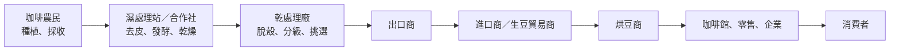

<callout icon="🎯" color="brown_bg">
<b>學習目標</b>

- 看懂一袋生豆從農場到烘豆廠的完整供應鏈，以及每個環節如何影響品質
- 理解生豆與熟豆的包裝、運輸與倉儲原則
- 認識咖啡的價格形成、貿易條件與商業杯測流程
- 掌握台灣咖啡進口與食品衛生法規的重點，知道烘焙師與咖啡師各自要注意什麼
</callout>

<callout icon="⚖️" color="gray_bg">
本篇的法規內容是學習用的重點整理。法規會修正，實際開業、進口或被稽查時，請以衛福部食品藥物管理署、地方衛生局與報關業者的最新說明為準。
</callout>

## 1. 供應鏈全貌

你手上這杯咖啡，在變成飲料之前已經轉過好幾手。這一節先畫出整條路線，因為後面談到的品質、價格與法規，都發生在其中某一段。

一支咖啡往往要經過六、七手才到消費者手中。每多一手，品種、農場、處理細節這些資訊就可能少一點，成本也多加一層，像傳話遊戲一樣越傳越模糊。

<b>直接貿易</b>是縮短這條鏈的做法：烘豆商直接與農場或處理站談價格與品質。不過物流、通關與資金調度仍然需要出口商與進口商，所以「直接」指的是談判關係，不代表中間環節全部消失。

農民的收入佔比是另一個核心議題。一杯幾十到上百元的咖啡裡，農民拿到的通常只是很小的一部分，這正是公平貿易、競標與價格透明運動關心的事。

## 2. 乾處理與出口準備

產地處理完的豆子，還不能直接裝船。這一節說明豆子在出口前最後一站做了什麼，你在生豆袋上看到的等級與袋重，都是在這裡決定的。

帶殼豆（外面還包著一層羊皮紙般薄殼，也叫羊皮紙豆）或日曬乾果，出口前要在乾處理廠（dry mill）完成以下步驟：

1. <b>脫殼（hulling）</b>：去除羊皮紙層或乾果皮
2. <b>拋光</b>（部分產區）：磨去殘留銀皮，讓外觀更乾淨
3. <b>尺寸分級</b>：用篩網分出不同大小（第 01 篇）
4. <b>密度分級</b>：用重力台（gravity table）振動分出輕豆，輕豆常是未熟或蟲蛀豆
5. <b>光學色選</b>：機器以相機剔除顏色異常的豆子，例如黑豆、發酵豆
6. <b>人工挑豆</b>：精品微批次常再以人工複檢
7. <b>秤重裝袋、取樣</b>：留下裝運前樣品給買家杯測

### 常見的標準袋重

各產地習慣的袋重不同，看報價或庫存時要先弄清楚「一袋」是幾公斤。

| 產地 | 常見袋重 |
| --- | --- |
| 巴西、衣索比亞、肯亞、多數非洲與亞洲產區 | 60 公斤（國際統計的「一袋」也以 60 公斤計） |
| 哥倫比亞 | 70 公斤 |
| 中美洲多國 | 69 公斤（瓜地馬拉、宏都拉斯、薩爾瓦多、尼加拉瓜、哥斯大黎加等；巴拿馬多為 60 公斤） |
| 精品微批次 | 常見 30 公斤或更小的箱裝、真空包裝 |

一個 20 呎貨櫃依袋重不同，大約可裝 250 到 320 袋、十幾到二十公噸的生豆（60 公斤袋約 320 袋、19 公噸上下），這是大宗貿易的基本單位。小型烘豆商通常向進口商「拆袋」購買，而不是自己進整櫃。

## 3. 生豆的包裝、運輸與倉儲

同一批豆子到港時可能和產地杯測時喝起來不一樣，差別往往出在包裝、運輸與倉儲。

### 包裝

| 方式 | 說明 | 優缺點 |
| --- | --- | --- |
| <b>麻袋（Jute）</b> | 傳統的黃麻袋 | 便宜、透氣，但會與外界交換水氣與氣味，生豆老化快，也可能沾染麻袋味 |
| <b>麻袋＋高阻隔內袋</b> | 麻袋內套一層多層塑膠阻隔袋（業界常以品牌 GrainPro 代稱） | 穩定含水率與氣味，延緩老化，是精品生豆的常態 |
| 真空包裝箱裝 | 抽真空後裝箱 | 保存效果最好，常用於競標豆與高價微批次，成本最高 |
| 散裝貨櫃（bulk liner） | 貨櫃內鋪大型內襯，直接倒入生豆 | 用於大宗商業豆，節省包材與搬運 |

### 海運風險

<b>貨櫃雨（container rain）</b>是最典型的問題。生豆本身含水，貨櫃穿越不同氣候區、日夜溫差大時，水氣會在櫃頂凝結滴下，像冬天浴室天花板滴水一樣，讓上層生豆受潮發霉。常見對策是在櫃壁與櫃頂鋪吸濕紙板、放乾燥劑，並選擇不曝曬的堆放位置。

受潮的生豆可能長出會產生<b>赭麴毒素</b>（Ochratoxin A）的黴菌，這是食安關注的重點，第 7 節會再談。

高溫也會加速老化。港口曝曬與熱帶航線都是風險，精品生豆有時會用冷藏貨櫃或溫控倉儲。

海運時間依航線從數週到一個多月不等，再加上通關與內陸運輸，這就是「新產季」上市總比採收晚好幾個月的原因。

### 倉儲原則

- <b>陰涼、乾燥、穩定</b>：常見的實務目標是溫度低於約 25°C、相對濕度約 60% 以下，並避免劇烈波動
- <b>離地離牆</b>：用棧板堆放，留下通風與檢查空間，防蟲防鼠
- <b>遠離異味</b>：生豆會吸附氣味，不要與香料、清潔劑、燃料放在一起
- <b>先進先出（FIFO）</b>並定期杯測追蹤：生豆老化（業界稱 past crop，指上一產季的舊豆）的徵兆是酸質變平，出現紙板、麻袋、木頭味，生豆顏色也會從藍綠轉為黃褐

## 4. 熟豆的包裝

生豆怕水氣，烘好的熟豆則怕氧氣。你買豆子時看到袋上的小圓孔、鋁箔內層，各有用途。

| 元素 | 作用 |
| --- | --- |
| <b>單向排氣閥</b> | 讓熟豆釋放的 CO2 排出，且外部空氣不會進入；沒有它，封口後袋子會膨脹 |
| 多層阻隔袋（鋁箔或高阻隔塑料） | 阻擋氧氣、光線與濕氣，延緩油脂氧化 |
| 充氮 | 封口前用氮氣置換袋內空氣，大廠與濾掛、膠囊常用 |
| 封口與夾鏈 | 開封後能重複密封，減少每次開封接觸的空氣 |

熟豆運送要避熱，夏天的車內、日曬的物流站都會讓風味快速流失。

濾掛式咖啡在台灣很普及。它是「先磨好」的產品，磨成粉後接觸氧氣的面積大增，所以包裝阻隔與充氮的品質幾乎決定了風味。

## 5. 咖啡的價格從哪裡來

咖啡館漲價時常說是「國際豆價上漲」。這一節說明那個豆價是什麼，以及精品咖啡為什麼走另一套定價。

### C 市場：咖啡的國際基準價

阿拉比卡的國際基準價，是紐約洲際交易所（ICE）的阿拉比卡期貨，常稱 <b>C 市場（C market）</b>，以美分／磅報價；羅布斯塔則以倫敦市場的美元／公噸報價。期貨是約定未來交貨的合約，它的價格反映市場對供需的預期。

實際的生豆價格常寫成「<b>C 市場價格 ± 差價（differential）</b>」：品質好、產區受歡迎的豆子加價，品質差的減價。

期貨價格受巴西天氣（霜害、乾旱）、全球庫存、匯率、貿易政策與投機資金影響，波動很大。2024 到 2025 年一路上漲，2025 年曾突破每磅 4 美元的歷史高位；2026 年隨著巴西大豐收的預期回落，年中一度跌到一年多來的低點。2026 年 10 月大致在每磅 2.9 到 3.1 美元間波動。知道這個背景，就能理解咖啡館與烘豆商為什麼會跟著調價。

### 精品咖啡的定價

精品微批次通常與 C 市場<b>脫鉤</b>，由品質（杯測分數）、稀有度與買賣雙方關係決定固定價格。

<b>競標</b>（Cup of Excellence、Best of Panama 等）則讓頂級批次由市場出價。另外，部分烘豆商會公開「透明採購報告」，列出付給生產者的價格，這是北歐與第三波的傳統（第 07 篇）。

### 貿易條件（常見國際貿易術語）

談好價格後，還要談清楚貨在哪裡交、運費誰付、出事算誰的。國際上用一組標準術語（Incoterms）來約定，下表是簡化說法。

| 條件 | 意思 | 風險何時轉給買方（簡化說法） |
| --- | --- | --- |
| <b>EXW（工廠交貨）</b> | 買方到賣方倉庫提貨，其餘自理 | 出倉就是買方的 |
| <b>FOB（船上交貨）</b> | 賣方負責把貨運到出口港並裝上船，生豆報價最常見的基準 | 裝上船後 |
| <b>CIF（含運費保險）</b> | 賣方付到目的港的運費與保險 | 裝上船後（但保險由賣方投保） |
| <b>DAP／DDP</b> | 送到指定地點；DDP 還含進口稅費 | 送達後 |

對小型烘豆商來說，最常見的是向台灣的生豆進口商買「在台現貨」，對方已經處理好運輸、通關與倉儲。

### 永續與法規趨勢

<b>歐盟零毀林法規（EUDR）</b>要求進入歐盟的咖啡等商品，證明來自 2020 年底後未曾毀林的土地，並可追溯到地塊。它經過兩次延後，目前預定 2026 年 12 月 30 日起對大型與中型業者適用，多數微型與小型業者則延到 2027 年 6 月 30 日。咖啡生豆與烘焙咖啡在原本的範圍內；2026 年 7 月歐盟執委會另把即溶咖啡納入，這類新增品項到 2027 年 12 月 30 日才適用（以上依 2026 年 11 月查得的報導，細節以歐盟最新公告為準）。它不只影響歐洲，也迫使產地建立 GPS 地塊與追溯資料，小農的合規成本是主要爭議。

## 6. 商業杯測：用杯子做生意

價格談的是「多少錢」，杯測確認的是「值不值」。買家靠一連串樣品確認最後拿到的就是當初喝到的豆子。

### 樣品的生命週期

| 樣品 | 時間點 | 用途 |
| --- | --- | --- |
| <b>報價樣（Offer sample）</b> | 買賣前 | 買家杯測決定要不要買、談價 |
| <b>裝運前樣（Pre-shipment sample, PSS）</b> | 出口前，從準備裝櫃的批次取樣 | 確認要運的東西和報價樣一致；不符可以拒絕裝運 |
| <b>到貨樣（Arrival sample）</b> | 到港後 | 確認運輸中沒有受潮、沾染異味或老化 |
| <b>現貨樣（Spot sample）</b> | 已在進口商倉庫 | 烘豆商向進口商選豆時杯測 |

### 生豆的物理檢驗

杯測前通常先做物理檢驗：

- <b>含水率與水活性</b>（第 02 篇第 8 節）
- <b>瑕疵計數</b>：依 SCA（精品咖啡協會）的生豆分級標準，精品級生豆在 350g 樣本中不能有一級瑕疵，二級瑕疵換算後不超過 5 個全瑕疵。一級瑕疵例如全黑豆、全酸豆、乾果、黴豆、異物、嚴重蟲蛀；二級瑕疵例如部分黑豆、破碎豆、輕微蟲蛀、未熟豆，要累積幾顆才算一個全瑕疵
- <b>篩網分布</b>、<b>顏色與氣味</b>

檢驗不合格時，買方可以折價、要求更換或拒收，實際依合約而定。

### 樣品烘焙

商業杯測用小型樣品烘豆機（sample roaster）烘成偏淺、發展充分的「杯測烘焙」，目的是公平呈現生豆本質，而不是做出最好喝的產品。烘壞的樣品會讓好豆被低估，所以樣品烘焙本身也是一門技術。

## 7. 台灣的咖啡進口

接下來看豆子抵達台灣時要過哪些關。這對進口商最直接，烘豆商與想自己帶豆子回來賣的人也該知道。

台灣喝的咖啡絕大部分靠進口。依財政部統計，2021 年咖啡豆進口量約 4.1 萬公噸（2022 年約 4.3 萬公噸），國產咖啡豆一年大約只有七百到一千一百公噸，各來源數字略有出入（見第 10 篇）。

進口流程大致是：<b>報關 → 各主管機關簽審 → 食品邊境查驗 → 完稅放行</b>。財政部關務署負責關稅與通關，衛福部食品藥物管理署負責輸入食品查驗，地方衛生局負責市場端的稽查與抽驗；依貨品分類，可能還涉及動植物防疫檢疫。

<b>邊境查驗</b>的法源是食安法第 30 條（輸入公告的食品要向食藥署申請查驗），細節依「食品及相關產品輸入查驗辦法」辦理。這個辦法在 2025 年 8 月 21 日修正發布，依第 29 條，第 19 到 21 條（具結先行放行）自 2025 年 9 月 1 日施行，其餘條文自 2026 年 1 月 1 日施行。咖啡豆常見的抽驗項目包括<b>農藥殘留</b>與<b>赭麴毒素</b>，實際項目依食藥署當時的查驗規定而定。一般說法是歷年不合格率很低，但查驗是抽樣而非逐批，烘豆商自己的到貨檢驗仍然重要。

<b>赭麴毒素</b>是部分黴菌產生的毒素，具腎毒性，屬 2B 類可能致癌物，在高溫多濕、保存不當時容易產生。台灣的「食品中污染物質及毒素衛生標準」附表二，訂定烘焙咖啡豆及其研磨的咖啡粉赭麴毒素 A 限量為每公斤 5 微克（5 ppb，十億分之五），即溶咖啡為每公斤 10 微克；表中沒有另列生豆。乾燥良好的生豆（含水率約 12% 以下）與熟豆不易發霉，風險主要來自運輸與倉儲受潮。

<b>常見誤區</b>是自己出國帶回或網購進來分裝販賣。旅客攜帶入境的食品只限自用（依食藥署 2024 年 7 月的說明，非供販賣的一般食品，價值 1,000 美元以下且總重 6 公斤以內，才免申請輸入查驗），只要有販賣行為，不論數量多少都應依食安法第 30 條申請輸入查驗。未經查驗就上網販售，食藥署表示可依食安法第 47 條第 14 款處新台幣 3 萬元以上 300 萬元以下罰鍰。

## 8. 食品衛生安全：烘焙師與咖啡師的衛生法寶

豆子通過邊境後，責任就落在烘豆廠與咖啡館身上。這一節整理法規要求什麼、稽查最常抓什麼，以及日常該養成的習慣。

### 法規架構

| 法規 | 重點 |
| --- | --- |
| <b>食品安全衛生管理法</b>（食安法） | 母法。第 8 條規定食品業者的從業人員、作業場所、設施衛生管理與品保制度，都要符合良好衛生規範準則；公告類別與規模的業者需登錄才能營業。第 22 條規範包裝食品標示，第 28 條禁止不實或誤導的標示與廣告 |
| <b>食品良好衛生規範準則</b>（GHP 準則） | 人員、設備器具、作業場所、食材與製程衛生的基本要求，是所有食品業者的底線 |
| 食品業者登錄（「非登」系統） | 符合公告類別與規模的製造加工、餐飲、輸入、販售、物流業者都要登錄；例如具工廠、商業、公司或稅籍登記的餐飲業者都在範圍內（依食藥署 2021 年 4 月修正的公告） |
| 食品安全管制系統準則（HACCP） | 特定類別與規模的大型業者適用，小型咖啡館通常不在範圍內，但它「先分析危害、再盯住關鍵管制點」的觀念值得學 |

罰則參考（依現行食安法，2019 年 6 月 12 日修正版本）：違反 GHP 準則經限期改正仍未改正，依第 44 條第 1 項第 1 款可處新台幣 6 萬元以上 2 億元以下罰鍰；應登錄而未登錄，經限期改正仍未改正，依第 48 條第 2 款可處 3 萬元以上 300 萬元以下罰鍰。

衛生局稽查餐飲業時常公布的三大缺失是：<b>從業人員體檢資料不完整、未辦理食品業者登錄、食材未分區或直接放在地上</b>。這三件事都不難，只是容易忽略。

### 人員衛生（咖啡師與烘焙師共同）

以下依 GHP 準則第 5 條附件二（2025 年 6 月 4 日修正）整理。

- <b>健康檢查</b>：新進食品從業人員要先經醫療機構檢查 A 型肝炎、傷寒、出疹、膿瘡、外傷、手部皮膚病等項目合格才能聘僱，雇主每年至少主動辦理一次，並保存報告備查。罹患或感染這些疾病或其他可能污染食品的疾病期間，應主動告知現場主管，不得從事接觸食品的工作。2025 年修正時已刪除結核病檢查
- <b>教育訓練</b>：新進人員至少 3 小時，在職人員每年至少 3 小時，並作成紀錄；可由業者自行辦理或委託專業機構
- <b>服裝</b>：在作業場所穿戴整潔的工作衣帽（鞋）並戴口罩；不留指甲、不塗指甲油、不貼指甲片、作業時不戴飾物
- <b>手部清潔</b>：上工前、如廁後、碰觸垃圾或金錢後都要洗手；調理即食食品時，手不得同時或接續接觸金錢；手上有傷口要包紮並戴手套

### 咖啡師的衛生重點

| 項目 | 做法 | 為什麼 |
| --- | --- | --- |
| <b>蒸氣管</b> | 每次打奶後立刻用專用濕布擦拭並短暫排氣 | 牛奶殘留在溫熱的噴嘴內外是細菌溫床；不排氣時牛奶可能被吸回管內 |
| 牛奶與植物奶 | 冷藏保存、開封標示日期與時間、先進先出、不把打過的牛奶反覆加熱使用 | 乳製品是咖啡館最容易變質的食材 |
| <b>過敏原</b> | 牛奶、豆漿、堅果奶用不同拉花鋼杯或確實清洗；清楚告知客人飲品成分 | 交叉污染可能讓過敏客人受傷 |
| 磨豆機與沖煮頭 | 每日反沖洗、清潔粉碗與分水網；磨豆機定期拆洗刀盤周圍 | 咖啡油脂會氧化酸敗，帶來油耗味與苦味 |
| 冰塊與製冰機 | 用冰鏟取冰、不用杯子直接舀；製冰機定期清洗消毒 | 冰塊是食品，而且是稽查抽驗不合格的常客 |
| 淨水系統 | 依廠商建議更換濾芯並留紀錄 | 同時關係衛生、風味與機器壽命（水垢） |
| 抹布分色 | 蒸氣管、吧台、杯具、地板用不同顏色抹布 | 避免交叉污染 |
| 食材儲存 | 離地存放、加蓋、生熟分開、標示效期 | 稽查最常見的缺失之一 |

<b>咖啡因標示</b>：依「連鎖飲料便利商店及速食業之現場調製飲料標示規定」（依食安法第 25 條第 2 項訂定），具稅籍登記的連鎖飲料業、連鎖便利商店業與連鎖速食業，販賣的現場調製飲料要標示每杯總咖啡因含量。衛福部 2022 年 6 月 7 日公告修正、2023 年 1 月 1 日起適用的版本，範圍從咖啡擴及紅茶、綠茶、可可等所有含咖啡因成分的現調飲料，可標示最高值並加註「最高值」，或以紅黃綠區分：紅色每杯 201 毫克以上、黃色 101 到 200 毫克、綠色 100 毫克以下。同一規定也要求標示總糖量、總熱量，咖啡飲料要標示咖啡原料原產地，細節以現行公告為準。

### 烘焙師的衛生重點

烘焙師管的是一整批會賣給很多人的包裝食品，重點在原料、設備與追溯。

| 項目 | 做法 |
| --- | --- |
| <b>生豆倉儲</b> | 離地離牆、防蟲防鼠、控制溫濕度、先進先出；定期檢查是否受潮發霉 |
| 烘焙前挑豆 | 移除石頭、金屬、黴豆等異物與瑕疵豆；大廠常備去石機與金屬偵測 |
| <b>烘豆機與煙道</b> | 定期清理銀皮收集桶、旋風集塵與煙道。銀皮與煙道油垢可燃，是烘豆廠火災的主要來源之一 |
| 排煙與異味 | 烘焙產生的煙與氣味可能引起鄰里投訴，規模較大時需要考慮排煙處理設備與地方環保規定 |
| <b>熟豆包裝標示</b> | 包裝食品依食安法第 22 條標示，常見項目包括品名、內容物名稱、淨重、食品業者名稱地址電話、原產地、有效日期等；品名要與本質相符，不能誤導 |
| 批號與追溯 | 記錄每批生豆來源、烘焙日、包裝批號與出貨對象，出問題時能召回 |

### 案例：標示不實的代價

2019 年，台灣一個知名咖啡老品牌標示「100% 阿拉比卡」的咖啡豆產品，被檢出摻入羅布斯塔豆。臺北市衛生局稽查後比對進貨與用量不符，將案件移送士林地檢署，後續由檢調搜索並朝詐欺方向偵辦，涉案產品下架回收。

教訓是：<b>產地、品種、「100%」這類字眼都是法律承諾</b>。配方豆就要誠實寫配方，買不到新產季就要更新標籤。誠實標示同時保護消費者與品牌。

## 參考資料

- [發布修正食品及相關產品輸入查驗辦法（衛生福利部）](https://www.mohw.gov.tw/cp-7175-83560-1.html)：輸入查驗辦法 2025 年 8 月修正發布、分兩階段施行
- [EU Deforestation Regulation Reset: Simplified Compliance and Extended Implementation（Faegre Drinker）](https://www.faegredrinker.com/en/insights/publications/2026/1/eu-deforestation-regulation-reset-simplified-compliance-and-extended-implementation)：EUDR 延後後的適用日期
- [Arabica Coffee Futures Stay Below $3（Trading Economics）](https://tradingeconomics.com/commodity/coffee/news/547517)：2025 年阿拉比卡期貨曾破每磅 4 美元、2026 年因巴西供應充足回落
- [Arabica Coffee Futures Inch Higher（Trading Economics）](https://tradingeconomics.com/commodity/coffee/news/591484)：2026 年 10 月阿拉比卡期貨約每磅 2.9 美元上下
- [Coffee Weights（Royal Coffee）](https://cdn.royalcoffee.com/wp-content/uploads/2020/08/14100208/CoffeeWeights_FINAL.pdf)：各產地袋重與 20 呎貨櫃可裝袋數
- [Heritage Coffee Standards（SCA）](https://www.sca.coffee/heritage-coffee-standards)：精品級生豆瑕疵標準
- [現場調製飲料標示規定修正（中央社）](https://www.cna.com.tw/news/ahel/202206070149.aspx)：咖啡因標示的適用業者、分級與生效日
- [臺南市濾掛式咖啡赭麴毒素抽驗結果（臺南市政府衛生局）](https://health.tainan.gov.tw/warehouse/E8F91377-01E2-4EF9-B2EE-6E34DE864B39/F_1660038873725e.pdf)：烘焙咖啡豆及咖啡粉赭麴毒素 A 限量 5 ppb
- [返國入境攜帶食品僅能自用 不能上網賣（公視新聞網）](https://news.pts.org.tw/article/399690)：攜帶入境食品限自用、販賣的罰則
- [食品藥物管理署 106.12.15 FDA 北字第1062004955號（臺北市法規查詢）](https://laws.gov.taipei/law/Interpretation/RelatedLaw/FE333084)：違反第 8 條經限期不改正，依第 44 條處 6 萬元以上 2 億元以下
- [西雅圖咖啡摻偽案（食力）](https://www.foodnext.net/news/newsnow/paper/5739387557)：2019 年「100% 阿拉比卡」摻偽案的稽查與移送經過
- [台灣咖啡進口量（旺得富）](https://wantrich.chinatimes.com/news/20221116900084-420101)：2021 年咖啡豆進口量約 4 萬 866 公噸
- [食品安全衛生管理法（全國法規資料庫）](https://law.moj.gov.tw/LawClass/LawAll.aspx?pcode=L0040001)：第 8、22、28、30 條與第 44、47、48 條罰則（2026 年 11 月 24 日查閱條文）
- [食品良好衛生規範準則（全國法規資料庫）](https://law.moj.gov.tw/LawClass/LawAll.aspx?pcode=L0040122)：附件二從業人員健康檢查、教育訓練與服裝規定（2026 年 11 月 24 日查閱附件原文）
- [衛福部修正發布「食品良好衛生規範準則」（食藥署）](https://www.fda.gov.tw/tc/newsContent.aspx?cid=4&id=31086)：2025 年 6 月 4 日修正，刪除結核病檢查、明定教育訓練時數與戴口罩
- [食品及相關產品輸入查驗辦法（全國法規資料庫）](https://law.moj.gov.tw/LawClass/LawAll.aspx?pcode=L0040017)：2025 年 8 月 21 日修正、第 29 條施行日期
- [食品中污染物質及毒素衛生標準（全國法規資料庫）](https://law.moj.gov.tw/LawClass/LawAll.aspx?pcode=L0040138)：附表二咖啡類赭麴毒素 A 限量
- [現場調製飲料如何標示（食藥署）](https://www.fda.gov.tw/TC/PublishOtherEpaperContent.aspx?id=1525&tid=4875)：2022 年 6 月 7 日公告修正、含咖啡因現調飲料的標示方式與紅黃綠分級
- [食品法規重點（食藥署）](https://www.fda.gov.tw/tc/PublishOtherEpaperContent.aspx?id=1577&tid=5292)：現調飲料咖啡因標示自 2023 年 1 月 1 日起適用
- [國外食品未經查驗不得販賣（食藥署）](https://www.fda.gov.tw/tc/newsContent.aspx?cid=4&id=t622947)：自用免查驗限量與第 47 條第 14 款罰則
- [應申請登錄始得營業之食品業者類別、規模及實施日期修正對照表（食藥署）](https://www.fda.gov.tw/tc/includes/GetFile.ashx?id=f637551173813431548)：應登錄的業別與規模
- [EUDR product scope and information system（Baker McKenzie）](https://supplychaincompliance.bakermckenzie.com/2026/07/16/blog-post-eudr-european-commission-finalizes-the-eudr-product-scope-and-information-system-ahead-of-december-2026-application/)：2026 年 7 月納入即溶咖啡等品項、2027 年 12 月 30 日起適用

## 自我檢核

<callout icon="💬" color="gray_bg">
先自己回答，再展開參考答案。
</callout>

<toggle>
Q1 請說出一袋生豆從農場到咖啡館會經過哪些角色？直接貿易改變了什麼？

農民、濕處理站或合作社、乾處理廠、出口商、進口商（生豆貿易商）、烘豆商、咖啡館或零售。直接貿易讓烘豆商與生產者直接談品質與價格，資訊更透明、生產者通常分到更多，但物流、通關與資金仍常常需要出口商與進口商協助。
</toggle>

<toggle>
Q2 什麼是「貨櫃雨」？如何預防？

生豆含有水分，貨櫃在海運中經歷溫差時，水氣在櫃頂與櫃壁冷凝滴下，讓生豆受潮、發霉。預防方法包括使用高阻隔內袋、在櫃頂與櫃壁鋪吸濕紙板、放乾燥劑、避開曝曬的堆放位置，高價生豆可用溫控貨櫃。
</toggle>

<toggle>
Q3 為什麼精品生豆多用「麻袋＋高阻隔內袋」？

單用麻袋會讓生豆與外界交換水氣與氣味，含水率波動、吸附異味、老化加快。高阻隔內袋能穩定含水率與風味，延長生豆的最佳使用期；麻袋則提供外層保護，也方便搬運。
</toggle>

<toggle>
Q4 「C 市場 + 30 美分」代表什麼意思？為什麼精品微批次常不用這種定價？

代表以紐約阿拉比卡期貨價格為基準，再加上每磅 30 美分的品質或產區差價。精品微批次的價值來自杯測品質與稀有度，和大宗商品的供需關係不大，所以常以固定價格或競標定價，也讓生產者不必承受期貨市場的劇烈波動。
</toggle>

<toggle>
Q5 報價樣、裝運前樣、到貨樣各自要確認什麼？

報價樣用來決定要不要買與談價；裝運前樣確認即將裝櫃的批次與報價樣一致，不符可以拒絕裝運；到貨樣確認運輸過程中沒有受潮、發霉、沾染異味或明顯老化。三者合起來保障買家拿到的就是當初喝到的咖啡。
</toggle>

<toggle>
Q6 你開了一間小咖啡館，衛生局來稽查，最常見的三大缺失是什麼？你會怎麼預先準備？

從業人員體檢資料不完整、未辦理食品業者登錄、食材未分區或直接放地上。準備方式：每位員工到職前與每年做健康檢查，並把報告集中備查；開業前完成食品業者登錄；用層架與密封容器分區存放食材，全部離地、標示效期。
</toggle>

<toggle>
Q7 為什麼蒸氣管每次用完都要立刻擦拭並排氣？

牛奶殘留在溫熱的噴嘴上會迅速烤乾結塊、滋生細菌；停止打奶時管內可能形成負壓，把牛奶吸回管內。立刻擦拭與短暫排氣能清除外部殘留並把管內的牛奶吹出，同時保持下一杯奶泡的風味。
</toggle>

<toggle>
Q8 赭麴毒素是什麼？在咖啡供應鏈的哪個環節最需要控管？

是部分黴菌產生的毒素，具腎毒性，屬 2B 類可能致癌物。乾燥良好的生豆與熟豆不易發霉，風險主要來自產地乾燥不足、海運受潮與倉儲濕度過高，所以乾燥、包裝、運輸與倉儲是控管重點。台灣對烘焙咖啡豆及咖啡粉訂有 5 ppb 的限量（即溶咖啡 10 ppb），它也是咖啡豆常見的邊境抽驗項目。
</toggle>

<toggle>
Q9 烘豆廠為什麼要定期清理煙道與銀皮收集桶？

銀皮輕而易燃，煙道累積的油垢也可燃，遇到高溫或火星可能引發火災，是烘豆廠常見的火災原因。定期清理也能維持排風效率，讓烘焙曲線穩定。
</toggle>

<toggle>
Q10 朋友從日本帶回幾公斤咖啡豆，想分裝在網路上賣。你會提醒他什麼？

旅客攜帶入境的食品只限自用，只要有販賣行為，不論數量多少都應依規定向食品藥物管理署報驗，未經查驗就上網賣可能被處 3 萬元以上 300 萬元以下罰鍰；分裝販售還涉及食品業者登錄與包裝標示等規定。建議先請教報關業者或衛生局。
</toggle>

<toggle>
Q11 EUDR 是什麼？為什麼說它對小農影響特別大？

是歐盟零毀林法規，要求進入歐盟的咖啡等商品證明來自 2020 年底後未毀林的土地，並可追溯到地塊座標。小農往往沒有完整的土地資料與數位工具，合規成本相對很高，若供應鏈無法協助，可能被排除在歐洲市場之外。
</toggle>
